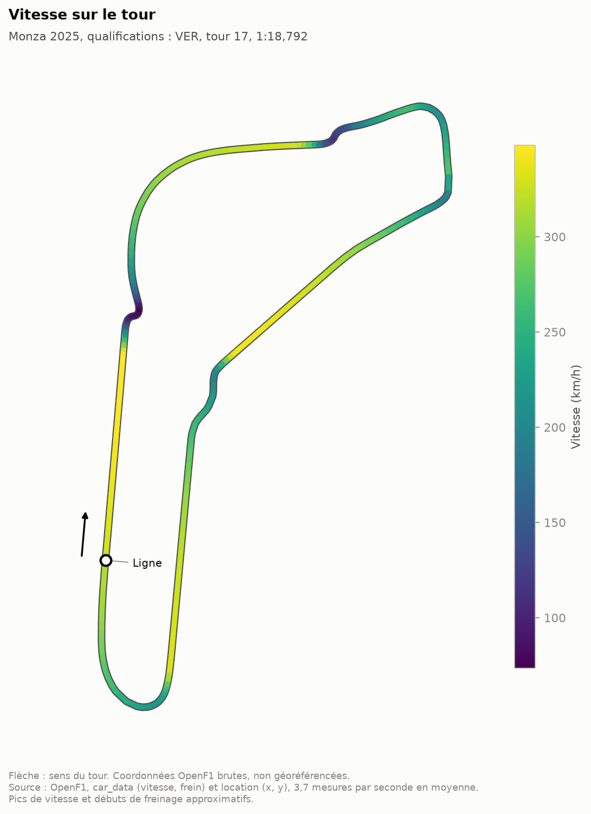
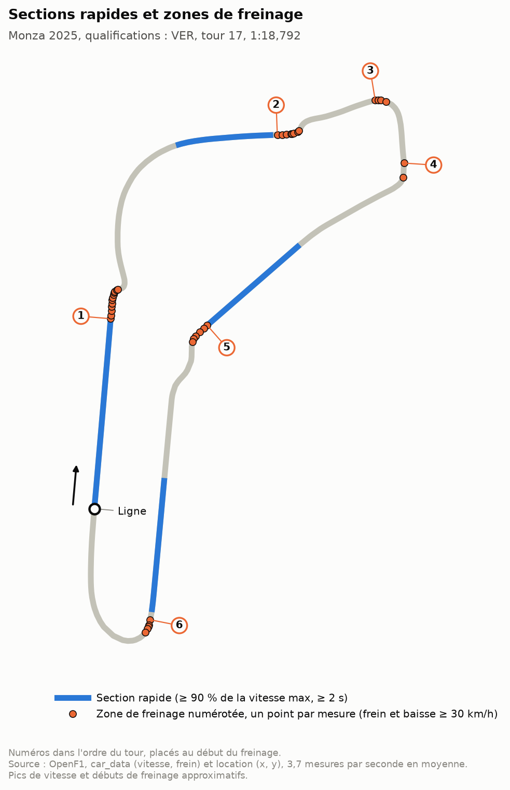
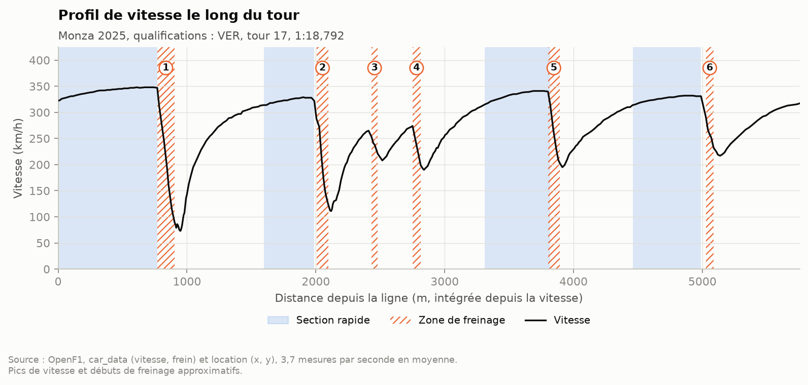

# Carte de vitesse F1

À quelle vitesse roule vraiment une F1 sur un tour ? Je trace la carte d'un circuit à partir des positions enregistrées sur un tour de qualification. Je colore le tracé selon la vitesse et je repère les sections rapides et les zones de freinage.

## Pourquoi ce projet

Dans le [Moteur de stratégie F1](../moteur-strategie-f1), je regardais la vitesse en fonction de la distance. C'est précis, mais on ne voit pas le circuit. Je voulais un projet plus simple, centré sur une seule question, avec une figure qu'on lit sans légende compliquée : où la voiture va vite, où elle freine, et combien de temps elle passe à fond.

C'est aussi un exercice de données que je n'avais pas encore fait : aligner deux flux mesurés à des instants différents.

## Ce que j'ai fait

**Les données.** J'utilise [OpenF1](https://openf1.org), comme dans les autres projets du portfolio. L'API est publique, sans compte. Le projet reste autonome : il a son propre petit client, avec un cache disque et une limite de débit, et seulement quatre dépendances. J'aurais pu réutiliser le client du moteur de stratégie, mais il aurait fait venir sa base SQL et ses modèles, qui ne servent à rien ici.

Pour un tour, je fais six requêtes :
- `sessions` : la séance « Qualifying » du circuit et de l'année demandés (pas la qualification sprint) ;
- `drivers` : les codes des pilotes ;
- `laps` : les temps au tour ;
- `race_control` : les messages de la direction de course, pour écarter les tours annulés ;
- `car_data` : vitesse, accélérateur et frein ;
- `location` : les coordonnées x et y de la voiture.

Par défaut, je prends Monza, qualifications 2025, et le tour le plus rapide de la séance. Monza a de longues lignes droites et des freinages très marqués aux chicanes, et le moteur de stratégie l'a déjà étudié. On peut changer d'année, de circuit et de pilote en option.

**Le choix du tour.** Je garde le tour le plus court parmi les tours chronométrés, en écartant les tours de sortie des stands et les tours annulés. Le champ `laps` d'OpenF1 ne signale pas les tours annulés pour limites de piste. Je lis donc les messages de la direction de course, de deux formes :
- « CAR 55 (SAI) TIME 1:20.470 DELETED - TRACK LIMITS AT TURN 7 LAP 3 16:03:35 » : je retrouve le tour par son temps ;
- « CAR 30 (LAW) LAP DELETED - TRACK LIMITS AT TURN 6 LAP 6 16:16:28 (PIT) » : sans temps, je prends le dernier tour du pilote terminé avant la publication du message.

Je ne me sers pas du numéro « LAP n » des messages. À Monza, il vaut le numéro de tour OpenF1 plus 1 dans les cinq messages de la séance : je l'ai vérifié par les temps et par les heures. Une réintégration publiée plus tard annule l'exclusion.

**L'alignement des deux flux.** `car_data` et `location` sont mesurés environ 3,7 fois par seconde, mais pas aux mêmes instants. Je prends les instants de `car_data` comme référence, parce que le frein ne vaut que 0 ou 100 et ne s'interpole pas. Sur ces instants, j'interpole linéairement les positions x et y. Je demande une seconde de plus de chaque côté du tour, pour ne jamais extrapoler aux bornes. J'ajoute deux points au début et à la fin exacts du tour. Si deux positions successives sont espacées de plus d'une seconde, je retire les mesures qui tombent entre les deux, et je compte ces retraits.

**La distance.** Je l'intègre à partir de la vitesse (méthode des trapèzes), comme dans le moteur de stratégie. Je calcule aussi la longueur du tracé x et y. OpenF1 ne donne pas l'unité de ses coordonnées : le rapport entre les deux longueurs permet de l'estimer.

**Les définitions.** Ce sont des choix de ma part, réglables en option :

| Notion | Définition | Pourquoi ce seuil |
|---|---|---|
| À fond | accélérateur ≥ 98 % | un seuil strict à 100 % raterait une mesure à 99 % ; sur ce tour, les valeurs au-dessus de 90 % sont 95 et 100, donc 98 ou 100 donnent le même résultat |
| Section rapide | vitesse ≥ 90 % de la vitesse maximale du tour, pendant au moins 2 s | un seuil relatif marche sur tous les circuits ; la durée écarte les mesures isolées |
| Zone de freinage | au moins 2 mesures de frein consécutives, et une baisse d'au moins 30 km/h | écarte les simples touches de frein ; une seule mesure sans frein au milieu d'un freinage est fusionnée |

Les parts du tour sont des parts du temps : chaque mesure compte pour l'intervalle jusqu'à la suivante. La vitesse moyenne est la distance intégrée divisée par le temps du tour. La vitesse d'un freinage est mesurée de la dernière mesure avant le frein jusqu'au point bas qui suit, là où la vitesse remonte.

**Les figures.** J'en trace trois, avec la palette viridis, qui est lisible par les daltoniens et ne passe pas par un arc-en-ciel :
- la carte du circuit colorée selon la vitesse, avec une barre de couleur en km/h, la ligne de départ et le sens du tour ;
- la carte des zones : sections rapides en trait plein, freinages en points (un par mesure), numérotés dans l'ordre du tour ;
- le profil de vitesse en fonction de la distance, avec les mêmes zones et les mêmes numéros.

Les coordonnées sont tracées telles qu'OpenF1 les donne, sans rotation ni retournement. Pour Monza, la carte sort dans le bon sens : le tour se fait dans le sens des aiguilles d'une montre, comme sur le vrai circuit, et ce n'est pas une image en miroir.

## Ce que ça donne

Le tour retenu est le tour 17 de Verstappen, en 1:18,792. C'est son temps en Q3 et la pole position, d'après le [classement officiel des qualifications](https://www.formula1.com/en/results/2025/races/1268/italy/qualifying) sur formula1.com.

### La réponse

| Indicateur | Valeur sur ce tour |
|---|---|
| Vitesse maximale | 348 km/h |
| Vitesse minimale | 73 km/h |
| Vitesse moyenne | 263,0 km/h |
| Part du temps à fond | 78,1 % |
| Part du temps au freinage | 14,1 % |
| Zones de freinage | 6 |
| Sections rapides | 4 |

Verstappen passe plus des trois quarts du tour à fond, et environ un septième sur les freins. La vitesse maximale mesurée vaut exactement la vitesse au piège à vitesse qu'OpenF1 donne pour ce tour (348 km/h), qui est une mesure séparée. La vitesse moyenne recalculée avec la longueur officielle (5,793 km, [formula1.com](https://www.formula1.com/en/racing/2025/italy)) et le temps du tour donne 264,7 km/h, soit 1,7 km/h de plus que la mienne : l'écart vient de la distance intégrée (voir plus bas).



### Les freinages



| N° | Virage (d'après la carte) | Début du freinage | Vitesse avant | Vitesse au point bas | Baisse |
|---|---|---|---|---|---|
| 1 | Première chicane (Rettifilo) | 769 m | 348 km/h | 79 km/h | 269 km/h |
| 2 | Chicane de la Roggia | 2 005 m | 322 km/h | 111 km/h | 211 km/h |
| 3 | Premier Lesmo | 2 432 m | 265 km/h | 208 km/h | 57 km/h |
| 4 | Second Lesmo | 2 750 m | 274 km/h | 190 km/h | 84 km/h |
| 5 | Chicane Ascari | 3 801 m | 341 km/h | 195 km/h | 146 km/h |
| 6 | Parabolica | 5 027 m | 331 km/h | 217 km/h | 114 km/h |

Les distances sont comptées depuis la ligne. Le premier freinage est de loin le plus violent : 269 km/h perdus à l'entrée de la première chicane. La vitesse minimale du tour (73 km/h) est un peu plus loin, dans la seconde partie de cette chicane, après une courte réaccélération. Les quatre sections rapides sont les lignes droites qui précèdent les freinages 1, 2, 5 et 6.



### La qualité des mesures

| Contrôle | Résultat |
|---|---|
| Mesures dans le tour | 291, dont les 2 points ajoutés aux bornes ; aucune retirée |
| Fréquence moyenne | 3,7 mesures par seconde (écart médian de 0,24 s) |
| Plus grands écarts entre deux mesures | 0,96 s à 2 750 m (juste après le début du freinage 4) et 0,88 s à 5 220 m |
| Distance intégrée depuis la vitesse | 5 757 m, soit 0,6 % de moins que les 5 793 m officiels |
| Longueur du tracé x et y | 57 516 unités |
| Unité estimée des coordonnées | environ 10 cm (9,99 unités par mètre de distance intégrée, 9,93 par mètre officiel) |
| Volume téléchargé | 6 réponses, 281 Ko |
| Tours annulés dans la séance | 5 (Sainz, Albon, Lawson, Norris deux fois), aucun n'est le tour retenu |

L'unité des coordonnées n'est qu'une estimation. Si c'est bien le décimètre, la longueur du tracé x et y fait 5 752 m. Elle concorde alors à 0,1 % près avec la distance intégrée, alors que les deux mesures viennent de flux différents.

**L'écart de distance avec le moteur de stratégie.** Le moteur de stratégie trouvait des distances de 1 à 1,5 % plus courtes que la longueur officielle. Sur ce tour, j'en explique un peu moins de la moitié. Sa méthode intègre seulement les mesures qui tombent dans le tour, et il manque alors 0,3 s en tout, au début et à la fin. Avec cette méthode, je trouve 5 729 m, soit 1,1 % de moins que la longueur officielle. En ajoutant les deux points interpolés aux bornes, je remonte à 5 757 m. Les 36 m restants (0,6 %) ne s'expliquent pas avec mes données. La trajectoire de la voiture peut être plus courte que la ligne de mesure officielle, mais je ne peux pas le vérifier. Je n'ai fait ce contrôle que sur ce tour de qualification, pas sur les tours de course du moteur de stratégie.

## Ce que j'en retiens

- Les données réelles ont contredit mes tests. J'avais supposé que le « LAP n » des messages d'annulation était le numéro de tour d'OpenF1, et mes données construites à la main reprenaient la même hypothèse. Sur la vraie séance, il est décalé de 1 : j'aurais écarté le tour suivant et gardé le tour annulé. Dans cette séance, l'erreur n'aurait changé le meilleur tour d'aucun pilote, mais elle était là, et mes tests ne pouvaient pas la voir.
- Deux flux « à 3,7 Hz » ne sont pas pour autant synchronisés. Il faut choisir un flux de référence et décider ce qu'on fait des trous, sinon on aligne des mesures qui ne correspondent pas au même endroit.
- La fréquence dépend de la façon de la calculer. L'écart médian entre deux mesures (0,24 s) donne 4,2 Hz, mais quelques trous de près d'une seconde ramènent la moyenne à 3,7 Hz. Et l'un de ces trous tombe en plein freinage.
- Un frein qui ne vaut que 0 ou 100 ne dit rien de la force du freinage. Pour séparer un vrai freinage d'une touche de pédale, il faut regarder la vitesse.

## Limites

- **Fréquence d'échantillonnage faible.** 3,7 mesures par seconde en moyenne. À 340 km/h, la voiture parcourt environ 25 m entre deux mesures. Le tracé est donc une suite de segments droits, et la vitesse maximale réelle peut tomber entre deux mesures.
- **Des trous au mauvais endroit.** Deux écarts de près d'une seconde (0,96 et 0,88 s), passés sous mon seuil de retrait de 1 s. Le premier tombe juste après la première mesure du freinage 4 : la vitesse passe de 274 à 199 km/h sans mesure intermédiaire, sur environ 65 m. On sait où ce freinage commence, mais pas comment la voiture décélère, et c'est pour cela qu'il n'a que deux points sur la carte. Plus généralement, un début de freinage tombe entre deux mesures espacées de 0,16 à 0,44 s selon le freinage, soit de 12 à 40 m à ces vitesses.
- **Coordonnées relatives.** Les positions OpenF1 sont dans un repère dont l'origine est arbitraire et l'unité non documentée. La carte n'est pas géoréférencée, et l'unité de 10 cm reste une estimation.
- **Distance approximative.** La distance intégrée sort 0,6 % plus courte que la longueur officielle, et je n'explique pas cet écart. Les positions des freinages en mètres en héritent.
- **Deux flux différents.** La vitesse et la position ne sont pas mesurées aux mêmes instants. Les positions sont interpolées, et une erreur d'horodatage entre les deux flux décalerait les couleurs le long du tracé.
- **Un seul tour d'un seul pilote.** Le résultat décrit ce tour-là, pas le circuit en général, ni une comparaison entre pilotes.
- **Des seuils choisis par moi.** À fond, section rapide, zone de freinage : les seuils sont raisonnables mais arbitraires. Le nombre de zones en dépend : le premier Lesmo (57 km/h de baisse) disparaîtrait avec un seuil de 60 km/h.
- **Frein binaire.** OpenF1 donne seulement « pédale enfoncée ou non ». Un léger appui pour placer la voiture compte comme un freinage, tant que la vitesse baisse assez.
- **Tours annulés.** Je les détecte en lisant le texte des messages de la direction de course. Le numéro de tour de ces messages est décalé de 1 à Monza, et je ne sais pas si c'est toujours le cas : c'est pour cela que je passe par le temps ou par l'heure. Un message d'une autre forme, ou publié longtemps après le tour (une décision tardive des commissaires par exemple), pourrait viser le mauvais tour. J'ai vérifié les cinq messages de Monza 2025, pas ceux des autres séances.
- **Les virages du tableau des freinages** sont identifiés d'après la forme de la carte, pas par une donnée d'OpenF1.

## Lancer le projet

Il faut Python 3.11 ou plus récent (testé avec 3.14.10 sur macOS arm64). Il n'y a ni compte, ni clé d'API, ni base de données.

```bash
cd projets/carte-vitesse-f1
python3 -m venv .venv
source .venv/bin/activate
pip install -r requirements.txt
pip install -e .

python -m f1carte   # Monza 2025, tour le plus rapide des qualifications
pytest              # 10 tests, sans réseau
```

Le premier lancement fait six requêtes à OpenF1 (281 Ko) et prend une vingtaine de secondes : une douzaine pour la limite de débit de l'API, le reste pour le cache de polices de matplotlib, construit une seule fois. Les réponses sont gardées dans `data/raw/`, et les lancements suivants n'appellent plus l'API. Pendant une session de F1 en direct, OpenF1 refuse les requêtes anonymes, même sur les séances passées (erreur 401, « Live F1 session in progress ») : il faut relancer la commande après la fin de la session.

Options utiles :
- `--circuit Suzuka --annee 2025` : autre circuit (nom court OpenF1, par exemple `Spa-Francorchamps`) ;
- `--pilote LEC` : meilleur tour d'un pilote donné ;
- `--seuil-fond`, `--seuil-rapide`, `--duree-rapide`, `--freinage-baisse`, `--freinage-mesures` : les seuils du tableau des définitions.

Ce qui est produit, avec un préfixe `<circuit>_<année>_<pilote>` :
- `docs/*_carte_vitesse.png`, `docs/*_carte_zones.png` et `docs/*_profil_vitesse.png` : les trois figures ;
- `docs/results/*_indicateurs.csv` : les indicateurs du tour ;
- `docs/results/*_zones.csv` : chaque zone de freinage et chaque section rapide, avec sa position et ses vitesses.

```
carte-vitesse-f1/
├── src/f1carte/
│   ├── openf1.py      # client API avec cache et limite de débit
│   ├── config.py      # chemins et seuils par défaut
│   ├── tour.py        # choix du tour, tours annulés, alignement, distance, zones, indicateurs
│   ├── carte.py       # les trois figures
│   └── __main__.py    # la commande et ses options
├── tests/             # alignement, freinages, sections rapides, choix du tour, tours annulés, indicateurs
└── docs/              # figures et résultats CSV
```

## Stack

- Python 3.14
- OpenF1 (API publique)
- requests pour les appels à l'API
- numpy pour l'interpolation et les calculs
- matplotlib pour les cartes et le profil
- pytest

## Statut

Terminé (v1). Pistes pour la suite : comparer deux pilotes sur la même carte, et tester d'autres circuits pour voir si le décalage du numéro de tour dans les messages d'annulation se retrouve ailleurs.
