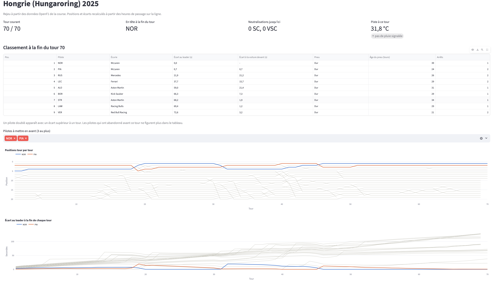
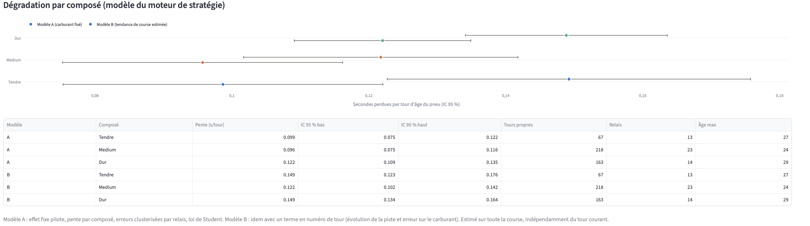
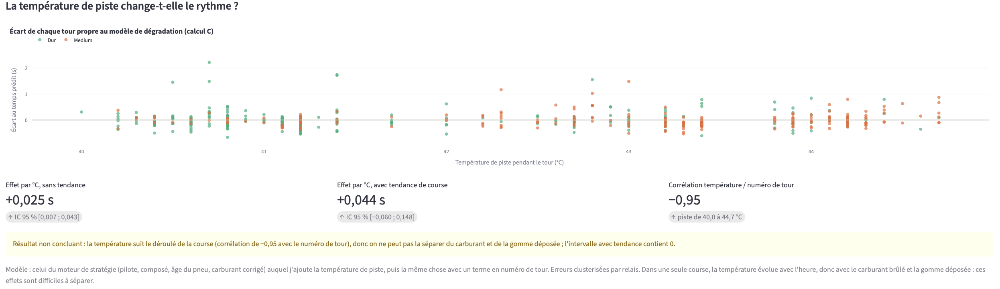
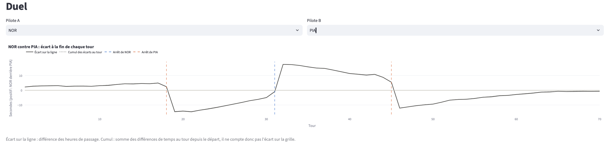
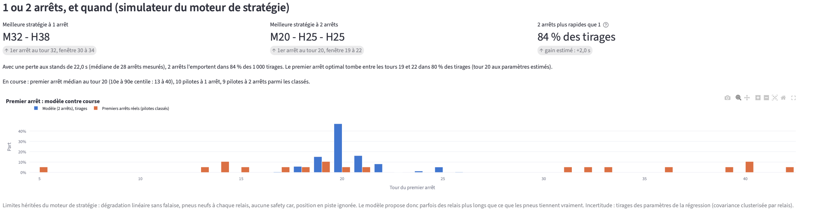
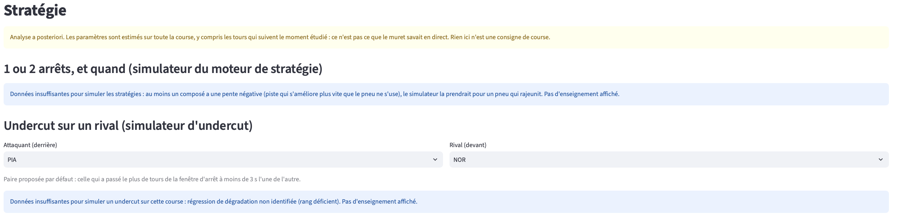

# Centre de commande F1

Un tableau de bord qui rejoue quatre Grands Prix 2025 tour par tour : positions, écarts, météo, pneus et enseignements de stratégie. Chaque chiffre s'affiche avec son incertitude, et le tableau de bord dit quand les données ne suffisent pas.

## Pourquoi ce projet

Dans les projets [Moteur de stratégie F1](../moteur-strategie-f1) et [Risque d'undercut F1](../risque-undercut-f1), j'ai construit des modèles : dégradation des pneus, simulateur 1 contre 2 arrêts, Monte Carlo d'un undercut. Leurs résultats tiennent dans des CSV et quelques graphiques fixes. Il me manquait l'étape où quelqu'un s'en sert pour lire une course : passer d'un tour à l'autre, comparer deux pilotes, voir si la météo bouge le rythme.

Je voulais aussi un vrai pipeline ETL, avec ce que ça demande : des sources qui ne s'alignent pas d'elles-mêmes (une mesure météo par minute, des tours d'environ 90 secondes), des trous, des contrôles de cohérence. Et je voulais tenir une règle que j'applique dans mon métier : pas de conclusion sans les chiffres qui la fondent. Si les données sont trop minces, l'outil doit le dire au lieu de recommander quelque chose.

**C'est un rejeu, pas du temps réel.** OpenF1 donne les données historiques gratuitement et sans compte, mais le direct demande un abonnement payant (formule Sponsor, 9,90 € par mois à la date du projet). Je n'ai pas cherché à simuler un faux direct : le curseur « tour courant » arrête les vues à un tour donné, mais les modèles sont estimés sur toute la course.

## Ce que j'ai fait

**Dépendance aux projets Moteur de stratégie F1 et Risque d'undercut F1.** Je réutilise leur code tel quel, installé en mode éditable (`pip install -e`) dans l'environnement de ce projet :
- du moteur de stratégie (`f1engine`) : le client OpenF1 avec cache, l'ingestion complète d'une course, le nettoyage des tours (safety cars, trafic, tours aberrants), la correction carburant, le schéma SQL, le modèle de dégradation et le simulateur 1 contre 2 arrêts ;
- du projet Risque d'undercut F1 (`f1risk`) : le filtre des relais incohérents, l'estimation des paramètres d'un circuit et le simulateur d'undercut.

Le centre de commande a sa propre base (`data/f1cc.db`) et son propre cache (`data/raw/`). Il ne lit ni n'écrit rien dans les dossiers `data/` des deux autres projets. Leurs chemins par défaut sont redirigés dans `src/f1cc/config.py`. Il lit seulement deux CSV versionnés du projet Risque d'undercut F1 (`docs/results/season_parameters.csv` et `neutralised_pit_losses.csv`), qui contiennent les taux de safety car et le coût de l'air sale estimés sur les 24 courses de 2025. Quatre courses ne suffiraient pas à les estimer.

**Les données.** Quatre courses de 2025, choisies pour leurs conditions :
- Bahreïn (Sakhir), Hongrie (Hungaroring) et Italie (Monza), déjà étudiées dans le moteur de stratégie, ce qui permet de vérifier que je retrouve les mêmes pentes ;
- Grande-Bretagne (Silverstone), une course sous la pluie, pour voir comment l'outil réagit quand les modèles ne tiennent plus.

Elles représentent 4 301 tours, dont 1 796 propres, 593 mesures météo et environ 24 800 points de télémétrie. Les endpoints OpenF1 utilisés sont `sessions`, `drivers`, `laps`, `stints`, `pit`, `race_control`, `intervals`, `car_data` (moteur de stratégie), plus `weather` et `session_result`. Cela fait 112 réponses et 22 Mo en cache. OpenF1 n'a pas d'endpoint d'état de la piste : je le reconstruis à partir des messages de la direction de course (code du moteur de stratégie) et de la température de piste.

**L'ETL** (`python -m f1cc etl`) :

```
OpenF1 ──► extraction ──► transformation ──► chargement (SQLite)
           (cache disque)

1. Code du moteur de stratégie : tours, relais, arrêts, direction de course, pilotes,
   télémétrie du tour le plus rapide, nettoyage des tours
                                      ──► sessions, drivers, laps, stints,
                                          pit_stops, race_control, telemetry
2. Météo et classement officiel (weather, session_result)
3. Transformation propre au centre de commande (transform.py) :
   - validation de la météo (doublons, valeurs hors plage physique)
   - correction des heures de début de tour isolément fausses
   - fin de chaque tour = début du tour suivant, sinon début + durée
   - position et écart au leader recalculés aux passages sur la ligne
   - météo rattachée au milieu de chaque tour
   - contrôles de cohérence
                                      ──► weather, results, lap_conditions,
                                          etl_checks (sql/schema_cc.sql)
```

Le rattachement de la météo suit trois cas, et chaque tour garde l'étiquette du cas qui s'applique :
- `measured` : une mesure à moins de 90 s du milieu du tour ;
- `interpolated` : pas de mesure assez proche, mais deux voisines espacées de 5 minutes au plus, entre lesquelles j'interpole linéairement ;
- `missing` : sinon, la valeur reste vide, sans extrapolation.

Un tour compte comme pluvieux si une mesure prise pendant ce tour signale de la pluie.

Avant de calculer positions et écarts, je contrôle chaque heure de début de tour. Elle doit tomber à la fois sur le début du tour précédent plus sa durée, et sur le début du tour suivant moins la durée du tour. Quand ces deux estimations s'accordent à 2 s près mais que l'heure publiée s'écarte des deux, c'est elle qui est fausse : je la remplace et je marque le tour (`timing_repaired`). La table `laps` du moteur de stratégie reste brute. Les tables ont des clés primaires et étrangères vers les tables du moteur de stratégie, et des contraintes `CHECK` sur les plages physiques et les états autorisés.

Les contrôles de cohérence, affichés sur une page du tableau de bord :
- heures de début de tour corrigées ;
- couverture météo des tours ;
- part de météo interpolée ;
- valeurs hors plage ;
- tours annoncés par le classement mais absents ;
- durée du tour comparée à l'écart entre deux passages sur la ligne ;
- classement recalculé comparé au classement officiel ;
- part de tours propres.

**Ce que « lap delta » veut dire ici.** J'ai retenu quatre calculs, du moins au plus coûteux en données :

| Calcul | Définition | Données |
|---|---|---|
| A. Écart au leader | heure de passage du pilote à la fin du tour n moins celle du leader | tours seulement |
| B. Duel | différence de temps au tour entre A et B, son cumul, et l'écart réel sur la ligne | tours seulement |
| C. Écart à une référence | temps corrigé du carburant moins le temps prédit par le modèle de dégradation du moteur de stratégie | tours seulement |
| D. Delta le long du tour | temps cumulé en fonction de la position dans le tour, sur le tour le plus rapide de chacun | télémétrie, limitée au tour le plus rapide de chaque pilote |

Pour D, la distance OpenF1 est intégrée depuis la vitesse et sort de 1 à 1,5 % trop courte, différemment selon le tour. Je la ramène en pourcentage du tour avant de comparer. C'est une lecture descriptive : les deux tours n'ont pas les mêmes pneus ni lieu au même moment de la course.

**Le modèle d'analyse** (`analysis.py`, `strategy.py`) :
- dégradation par gomme avec les modèles A et B du moteur de stratégie, plus une pente par relais (régression dans le relais, intervalle de Student), affichée seulement à partir de 8 tours propres ;
- lien entre température de piste et rythme : le modèle du moteur de stratégie auquel j'ajoute la température, puis la même chose avec un terme en numéro de tour. Le résultat n'est déclaré concluant que si la température varie d'au moins 2 °C, si sa corrélation avec le numéro de tour reste sous 0,7, et si les deux intervalles excluent 0 avec le même signe ;
- fenêtre d'arrêt : le simulateur du moteur de stratégie, relancé sur 1 000 tirages des paramètres de la régression. La fenêtre est l'intervalle à 80 % des premiers arrêts optimaux ;
- undercut : le simulateur d'undercut, appliqué aux écarts réellement observés entre deux pilotes dans la fenêtre d'arrêt habituelle du circuit.

**La règle des enseignements.** Une phrase d'enseignement est construite avec ses chiffres : effectifs, intervalle, nombre de tirages. Elle n'apparaît que si les seuils sont tenus :
- 30 tours propres et 3 relais par gomme, comme dans le moteur de stratégie ;
- 5 arrêts mesurés ;
- une régression identifiable ;
- un écart de 0 à 3 s pour l'undercut, le domaine validé dans le simulateur d'undercut.

Sinon, la page affiche « Données insuffisantes » avec la raison. Un tour d'arrêt n'est désigné comme meilleur que s'il dépasse le suivant à la fois de plus que le bruit Monte Carlo et d'au moins 5 points. Une pente de dégradation négative et significative bloque le simulateur : elle signale une piste qui sèche, pas un pneu qui rajeunit.

## Ce que ça donne

Le tableau de bord a six pages. La course et le tour courant se choisissent dans la barre latérale.

| Page | Ce qu'elle montre |
|---|---|
| Vue d'ensemble | classement au tour courant, positions et écart au leader tour par tour, safety cars et VSC |
| Rythme et pneus | relais de chaque pilote, rythme sur tours propres, pentes de dégradation par gomme et par relais avec IC 95 % |
| Météo et piste | air, piste, humidité, vent et pluie, puis l'effet de la température de piste sur le rythme et son verdict |
| Duel | écart sur la ligne et cumul des écarts au tour, écart de rythme moyen sur tours propres, delta le long du tour le plus rapide |
| Stratégie | 1 ou 2 arrêts et fenêtre du premier arrêt (moteur de stratégie), probabilité de réussite d'un undercut par tour (simulateur d'undercut) |
| Qualité des données | contrôles de l'ETL, motifs d'exclusion des tours, source de la météo |













### Les données

| Course | Tours | Tours propres | Mesures météo | Pluie signalée | Piste (°C) |
|---|---|---|---|---|---|
| Bahreïn | 1 129 | 448 (40 %) | 158 | 0 | 30,2 à 34,8 |
| Hongrie | 1 369 | 751 (55 %) | 136 | 0 | 30,6 à 36,5 |
| Monza | 976 | 503 (52 %) | 144 | 0 | 39,8 à 45,9 |
| Silverstone | 827 | 94 (11 %) | 155 | 28 | 20,0 à 29,6 |

La colonne « Piste » couvre toutes les mesures de la séance, y compris celles d'avant le départ. Pendant les tours de course, la plage est plus étroite : de 30,6 à 32,3 °C en Hongrie, par exemple. La météo couvre 100 % des tours des quatre courses, sans interpolation. Les pentes de dégradation de Bahreïn, de la Hongrie et de Monza recoupent celles du moteur de stratégie à 0,0015 s/tour près (test `test_consistency.py`). C'est le même écart que celui déjà constaté dans le projet Risque d'undercut F1, dû à une révision des données OpenF1.

**Des heures de passage fausses dans OpenF1.** En relisant le tableau de bord, j'ai vu Russell tomber à la 20e place à Bahreïn au tour 37, avec 70 s de retard, puis revenir 2e au tour suivant. C'était un artefact : OpenF1 publie un début de tour 38 décalé de 70 s, alors que les durées des tours 37 et 38 s'enchaînent à 0,5 s près avec le début du tour 39. La correction décrite plus haut traite ce cas, et 7 autres à Silverstone (décalages de 3 à 12 s, dont 6 pilotes sur le même tour 47, sans doute un défaut ponctuel du flux). La Vue d'ensemble signale les tours corrigés.

Deux autres contrôles restent « à vérifier » sur toutes les courses, et je les laisse ainsi :
- **La durée du tour et l'écart entre deux passages sur la ligne diffèrent de 0,05 à 0,06 s en médiane.** OpenF1 calcule les deux de façon un peu différente. L'écart au leader (A) et le cumul des écarts au tour (B) ne racontent donc pas exactement la même chose, même sans tour manquant.
- **Le classement recalculé diffère du classement officiel pour 2 à 3 pilotes** à Bahreïn, en Hongrie et à Monza. J'ai vérifié à Bahreïn : Hülkenberg est disqualifié, ce qui décalait toute la fin du classement avant que je ne compare que les pilotes classés. Il reste des pénalités en temps ajoutées au classement, comme les 10 s de Gasly en Hongrie pour un accrochage, d'après les messages de la direction de course. Je n'ai pas vérifié chaque écart un par un.

### Température et rythme : non concluant

| Course | Verdict | Pourquoi |
|---|---|---|
| Bahreïn | données insuffisantes | sur les tours propres, la piste ne varie que de 1,8 °C |
| Hongrie | données insuffisantes | 1,7 °C de variation |
| Silverstone | données insuffisantes | 1,2 °C sur les tours propres, qui sont presque tous en fin de course |
| Monza | non concluant | +0,025 s par °C [0,007 ; 0,043] sans tendance, mais +0,044 [−0,06 ; 0,15] avec, et une corrélation de −0,95 entre température et numéro de tour |

Je m'y attendais en partie, mais pas à ce point. Sur une course, la température de piste suit l'heure. Elle évolue donc avec le carburant brûlé et la gomme déposée, et une seule course ne permet pas de séparer ces effets. Monza est le seul cas où la température varie assez, et elle y baisse presque en ligne droite pendant la course. Le chiffre sans tendance a l'air significatif, mais il disparaît dès qu'on laisse le modèle estimer la tendance. La page le dit en clair.

### Stratégie : le modèle et la course divergent souvent

| Course | Verdict du modèle (moteur de stratégie) | Fenêtre du 1er arrêt (80 % des tirages) | 1er arrêt médian en course |
|---|---|---|---|
| Bahreïn | 2 arrêts dans 100 % des tirages | tours 18 à 20 | tour 12 |
| Hongrie | 2 arrêts dans 84 % des tirages | tours 19 à 22 | tour 20 |
| Monza | 1 arrêt dans 100 % des tirages | tours 19 à 25 | tour 33 |
| Silverstone | pas de simulation (pente négative, piste qui sèche) | | |

Pour la Hongrie, ces 84 % viennent de la simulation du centre de commande (1 000 tirages), alors que le [Moteur de stratégie F1](../moteur-strategie-f1) annonce 82 % (2 000 tirages) : ce sont deux simulations différentes du même modèle.

Le nombre d'arrêts correspond à ce qui s'est passé, comme dans le moteur de stratégie. Le moment de l'arrêt, lui, ne correspond qu'en Hongrie. À Bahreïn, les pilotes se sont arrêtés de six à huit tours plus tôt que le modèle ne l'aurait voulu. À Monza, ils se sont arrêtés dix tours plus tard. Le modèle ne connaît ni la chute brutale du pneu, ni la position en piste, ni les safety cars, et à Monza la dégradation est si faible que le moment de l'arrêt n'y change presque rien. La page signale ce désaccord au lieu de présenter la fenêtre du modèle comme le bon moment.

Pour l'undercut, la page choisit par défaut la paire de pilotes qui a passé le plus de tours de la fenêtre d'arrêt à moins de 3 s l'un de l'autre. Sur les trois courses sèches, la probabilité de réussite varie peu d'un tour à l'autre. Avec les paires proposées par défaut, aucun tour ne se détache du suivant de plus de 5 points. Le tableau de bord n'en désigne donc aucun.

## Ce que j'en retiens

- **Le plus long a été de rendre les chiffres honnêtes, pas de les calculer.** La règle « pas d'enseignement sans base chiffrée » m'a obligé à écrire autant de code pour les cas insuffisants que pour les cas normaux. C'est aussi ce qui m'a montré que l'undercut ne permettait jamais de désigner un tour.
- **Réutiliser le code des projets précédents a été rentable, à une condition.** Ils écrivent par défaut dans leurs propres dossiers, et une simple importation de `f1risk` aurait placé le cache de matplotlib dans le dossier du projet Risque d'undercut F1. Il faut lire ce que fait un module au moment de son importation, pas seulement ses fonctions.
- **Les contrôles de cohérence m'ont appris quelque chose sur les données.** Je pensais que la durée d'un tour et l'écart entre deux passages sur la ligne étaient la même mesure. Ils diffèrent de 0,05 à 0,06 s en médiane selon la course, de façon systématique.
- **Silverstone casse les modèles, et c'est utile.** Le modèle du moteur de stratégie y trouve une pente de −0,47 s par tour en medium : la piste séchait plus vite que les pneus ne s'usaient. Sans le contrôle des pentes négatives, le simulateur aurait cru à un pneu qui rajeunit.
- Si je recommençais, j'aurais choisi des courses où la température varie au milieu de la course (une course de jour qui se couvre, par exemple) pour la question de la météo. Avec ces quatre courses, elle ne pouvait pas trouver de réponse.

## Limites

- **Rejeu, pas temps réel.** Le direct d'OpenF1 est payant. Surtout, tout est calculé a posteriori : les modèles utilisent la course entière, y compris les tours qui suivent le tour courant. Le tableau de bord montre ce qu'on peut comprendre après coup, pas ce que le muret savait en direct.
- **Quatre courses.** Une seule course par circuit, une seule course sous la pluie. Les seuils de suffisance (30 tours, 3 relais, 5 arrêts, 2 °C, corrélation de 0,7, 5 points) sont des choix de ma part, pas des valeurs tirées d'une théorie.
- **Qualité et trous des données OpenF1.**
  - La météo n'arrive qu'une fois par minute, et la pluie n'est qu'un indicateur oui ou non, sans quantité. Il n'y a pas de mesure de l'état de la piste : je la déduis des messages de la direction de course, qui sont du texte.
  - Les écarts au leader viennent des heures de passage, qui diffèrent de la durée des tours de 0,05 à 0,06 s par tour en médiane, avec quelques tours au-delà d'une seconde (9 à Bahreïn, 14 à Silverstone).
  - Certaines heures de début de tour sont fausses (1 à Bahreïn, 7 à Silverstone). Je les corrige quand les deux tours voisins concordent. Une erreur sur deux tours de suite, ou un tour voisin sans durée, passerait sans correction et fausserait la position et l'écart de ce tour. Le moteur de stratégie et la validation du projet Risque d'undercut F1 utilisent ces heures brutes : je ne les ai pas modifiés, mais ce défaut peut les toucher aussi.
  - La télémétrie est échantillonnée à environ 3,7 Hz, et sa distance est approximative.
  - Je n'ai pas de quoi recouper les âges des pneus et les durées d'arrêt.
- **Hypothèses héritées du moteur de stratégie.** La correction carburant (0,03 s par kg, 100 kg, débit constant) pèse directement sur les pentes et sur le résidu de rythme (calcul C). La dégradation est linéaire, sans falaise. Les règles de tour propre, notamment le seuil de trafic de 1,5 s mesuré à la voiture précédente au classement, écartent de 45 à 60 % des tours sur piste sèche et 89 % à Silverstone. Le simulateur suppose des pneus neufs, aucune safety car et ignore la position en piste.
- **Hypothèses héritées du simulateur d'undercut.** Le rival répond au tour suivant. Les deux voitures ont le même rythme propre. Les paramètres de safety car sont des moyennes de saison. Sa validation sur 36 vraies tentatives ne contredit pas le modèle, mais ne prouve pas qu'il prédit bien (score de Brier de 0,227 contre 0,249 pour une probabilité constante). Ici, les paramètres du circuit sont estimés sur la course étudiée, pilotes concernés compris : c'est plus optimiste encore que la validation du simulateur d'undercut.
- **Limites des calculs d'écart.**
  - Le cumul des écarts au tour (B) saute les tours sans temps et ne compte pas l'écart sur la grille. Il peut donc s'éloigner de l'écart réel sur la ligne.
  - L'écart de rythme moyen entre deux pilotes compare des tours où les pneus ne sont pas forcément les mêmes, et son intervalle est un peu trop étroit parce que des tours consécutifs ne sont pas indépendants.
  - Le delta le long du tour (D) compare deux tours différents, avec une distance normalisée qui aligne mal les points précis comme les freinages.
  - Le résidu de rythme (C) dépend entièrement du modèle de dégradation.
- **Pas d'inspection visuelle automatisée.** Les tests vérifient que chaque page se charge sans erreur, pas que les graphiques sont lisibles ni que les étiquettes ne se chevauchent pas.

## Lancer le projet

Il faut Python 3.11 ou plus récent (testé avec 3.14.10 sur macOS arm64), et les dossiers des projets Moteur de stratégie F1 et Risque d'undercut F1 à côté de celui-ci (`projets/moteur-strategie-f1` et `projets/risque-undercut-f1`), dont le code est réutilisé. Leurs bases de données ne sont pas nécessaires. Il n'y a ni compte, ni clé d'API, ni service distant.

```bash
cd projets/centre-commande-f1
python3 -m venv .venv
source .venv/bin/activate
pip install -r requirements.txt
pip install -e ../moteur-strategie-f1  # Moteur de stratégie F1 (dépendance)
pip install -e ../risque-undercut-f1   # Risque d'undercut F1 (dépendance)
pip install -e .

python -m f1cc etl   # télécharge les 4 courses et construit data/f1cc.db
pytest               # 39 tests, dont 7 qui demandent la base locale
python -m f1cc app   # tableau de bord sur http://localhost:8501
```

Le premier `etl` télécharge 112 réponses d'OpenF1 (22 Mo, gardées dans `data/raw/`). À cause de la limite de débit de l'API (environ 30 requêtes par minute), cela prend de 4 à 5 minutes. Les lancements suivants lisent le cache et prennent quelques secondes. On peut changer de courses avec la variable `F1CC_CIRCUITS` (noms courts OpenF1 séparés par des virgules), par exemple `F1CC_CIRCUITS=Monza,Spa-Francorchamps python -m f1cc etl`. Pendant une session de F1 en direct, OpenF1 refuse les requêtes anonymes, même sur les courses passées (erreur 401, « Live F1 session in progress ») : il faut relancer `python -m f1cc etl` après la fin de la session.

Le tableau de bord se lance depuis ce dossier, pour que Streamlit lise `.streamlit/config.toml` : il n'écoute que sur `localhost`, n'ouvre pas le navigateur tout seul et n'envoie pas de statistiques d'usage. Ouvrir http://localhost:8501 dans un navigateur, puis arrêter avec Ctrl+C.

Sans base locale, `pytest` saute 7 tests (pages sur les vraies courses et cohérence avec le moteur de stratégie). Les autres tournent sur une course fictive construite à la main dans `tests/conftest.py`.

```
centre-commande-f1/
├── sql/schema_cc.sql       # tables de ce projet (météo, classement, conditions par tour, contrôles)
├── src/f1cc/
│   ├── config.py           # chemins, seuils, redirection des deux projets réutilisés
│   ├── etl.py              # extraction (code du moteur de stratégie + météo), chargement
│   ├── transform.py        # validation météo, alignement sur les tours, positions, contrôles
│   ├── analysis.py         # écarts A à D, dégradation, température et rythme
│   ├── strategy.py         # fenêtre d'arrêt (moteur de stratégie) et undercut (simulateur d'undercut)
│   ├── data.py             # lectures de la base pour le tableau de bord
│   ├── ui.py               # cache Streamlit, barre latérale, couleurs
│   ├── app.py              # navigation
│   └── pages/              # une page par vue
├── tests/                  # transformation, calculs, pages (AppTest), cohérence avec le moteur de stratégie
└── docs/                   # captures d'écran
```

## Stack

- Python 3.14
- OpenF1 (API publique)
- SQLite via SQLAlchemy
- pandas et numpy pour la transformation
- statsmodels et scipy pour les régressions et les intervalles
- Streamlit pour le tableau de bord, avec son cache et `streamlit.testing.v1.AppTest` pour les tests de pages
- Plotly pour les graphiques interactifs
- pytest
- Code d'ingestion, de nettoyage, de dégradation et de simulation repris du moteur de stratégie (`f1engine`) et du projet Risque d'undercut F1 (`f1risk`)

## Statut

Terminé (v1). Pistes pour la suite : un mode « ce que le muret savait », où les modèles ne sont estimés que sur les tours déjà courus, des courses où la température varie pendant la course, pour donner une vraie chance à la question météo, et un passage au direct si je prends l'abonnement OpenF1.
