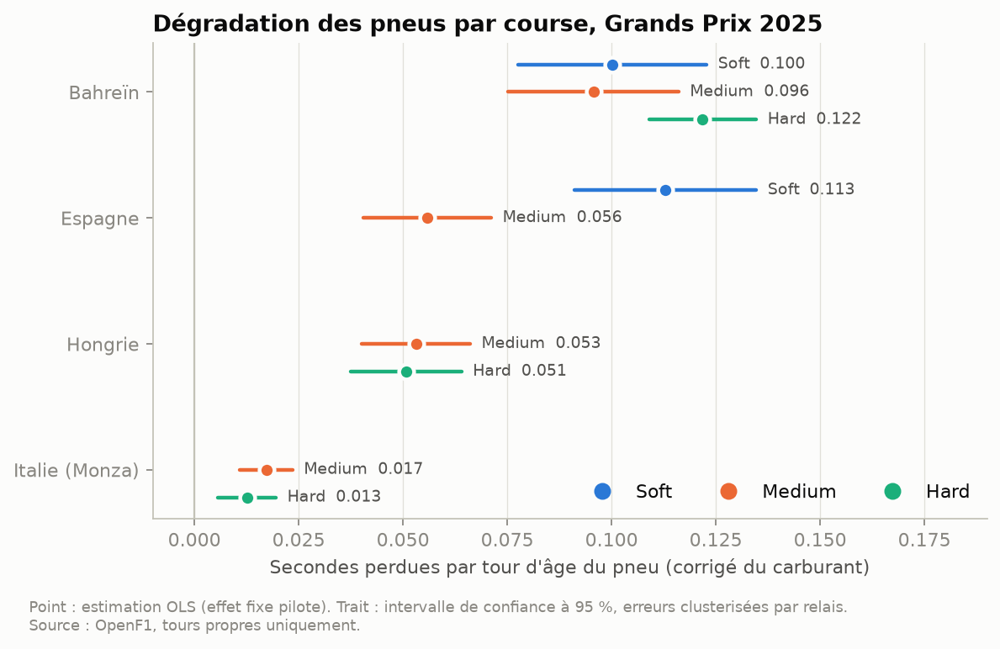
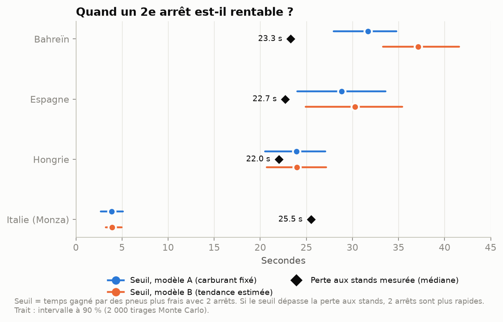
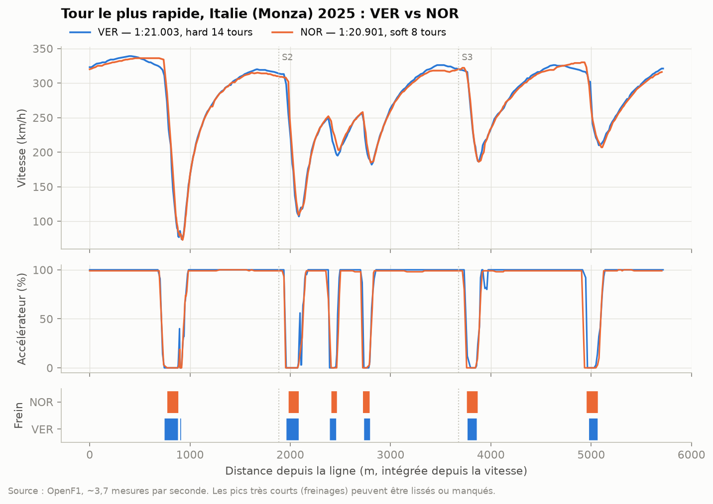

# Moteur de stratégie F1 : pneus, arrêts et télémétrie

Je charge les données de quatre Grands Prix 2025 dans une base SQL. Je les nettoie, puis j'estime à quelle vitesse chaque type de pneu se dégrade. Pour finir, je compare une stratégie à 1 arrêt et une à 2 arrêts, avec leur incertitude.

## Pourquoi ce projet

Je voulais un projet de données de bout en bout sur un vrai jeu de données, avec ses trous et ses pièges. Je cherchais aussi une question qui se tranche avec des chiffres. La stratégie en F1 s'y prête bien. S'arrêter coûte environ 20 secondes. Ne pas s'arrêter coûte quelques dixièmes par tour, qui s'accumulent à mesure que le pneu s'use. La bonne décision dépend de la vitesse de cette usure. C'est ce que je mesure avec les données.

Ça me rappelle mon métier dans les risques : comparer un coût fixe et connu à un coût diffus qu'on estime mal, puis décider quand même.

## Ce que j'ai fait

**Les données.** J'ai pris quatre courses de 2025 aux profils différents : Bahreïn (Sakhir), Espagne (Barcelone), Hongrie (Hungaroring) et Italie (Monza). Elles représentent 4 678 tours, 223 relais, 144 arrêts aux stands, les messages de la direction de course, et environ 24 500 points de télémétrie (vitesse, accélérateur, frein, DRS, rapport engagé).

J'avais prévu d'utiliser FastF1. Au moment de commencer, l'archive officielle de chronométrage qu'il interroge répondait « 401 » sans compte F1, et FastF1 demandait désormais des identifiants F1TV. J'ai donc utilisé [OpenF1](https://openf1.org), une API publique qui donne les mêmes données historiques sans compte. Le petit client que j'ai écrit garde chaque réponse sur le disque et respecte la limite d'environ 30 requêtes par minute.

**Le stockage.** J'utilise une base SQLite locale (`sql/schema.sql`) avec sept tables : `sessions`, `drivers`, `stints`, `pit_stops`, `race_control`, `laps` et `telemetry`. Le schéma comporte des clés primaires et étrangères, des contraintes `CHECK` (composés autorisés, âge du pneu ≥ 0, état de piste connu…) et des index pensés pour les requêtes. Pour la télémétrie, je ne garde que le tour le plus rapide de chaque pilote, sinon le volume explose.

**Le nettoyage** (`src/f1engine/cleaning.py`). Pour qu'un tour serve à mesurer l'usure des pneus, il faut qu'il soit représentatif. J'écarte donc :
- le premier tour, à cause du départ arrêté ;
- les tours d'entrée et de sortie des stands ;
- les tours sous safety car, VSC, drapeau rouge ou drapeau jaune. Je reconstruis les fenêtres de neutralisation à partir des messages de la direction de course (« SAFETY CAR DEPLOYED » … « TRACK CLEAR »), et le tour de relance est écarté lui aussi ;
- les tours dans le trafic, quand la voiture de devant est à moins de 1,5 s au début du tour ;
- les tours aberrants, au-delà de 107 % du temps médian du pilote ;
- les tours en pneus pluie ou de composé inconnu.

Ensuite, je corrige l'effet du carburant. Une voiture part avec environ 100 kg d'essence, et chaque kilo coûte à peu près 0,03 s au tour. Le temps corrigé retire donc `0,03 × carburant restant`.

**Les requêtes SQL** (`sql/queries/`, 8 fichiers commentés) couvrent :
- le rythme par composé ;
- la longueur des relais ;
- les fenêtres d'arrêt (avec `LAG` et `ROW_NUMBER`) ;
- le temps réellement perdu par un arrêt ;
- une courbe de dégradation « à la main » ;
- la télémétrie par secteur ;
- un duel entre deux pilotes, avec l'écart cumulé (`SUM … OVER`) ;
- un audit du nettoyage.

**Le modèle de dégradation** (`src/f1engine/degradation.py`). Pour chaque course, je fais une régression du temps corrigé sur l'âge du pneu, avec une pente par composé. Un effet fixe par pilote absorbe le niveau de chaque voiture. Les tours d'un même relais ne sont pas indépendants, donc je clusterise les erreurs standard par relais. Comme il y a peu de relais par composé, je calcule les intervalles avec une loi de Student plutôt qu'une loi normale.

**Le simulateur** (`src/f1engine/strategy.py`). À partir des pentes estimées, je cherche la meilleure stratégie à 1 arrêt et la meilleure à 2 arrêts. Je teste toutes les combinaisons de composés (au moins deux différents, comme l'impose le règlement) et tous les tours d'arrêt possibles. Le temps perdu aux stands est un paramètre. J'en déduis un seuil : la perte aux stands en dessous de laquelle 2 arrêts deviennent plus rapides. L'incertitude sur ce seuil vient de 2 000 tirages des paramètres du modèle.

## Ce que ça donne

### Dégradation des pneus



| Course | Composé | Pente (s/tour) | IC 95 % | Tours propres |
|---|---|---|---|---|
| Bahreïn | Tendre | 0,100 | [0,078 ; 0,123] | 67 |
| Bahreïn | Medium | 0,096 | [0,075 ; 0,116] | 218 |
| Bahreïn | Dur | 0,122 | [0,109 ; 0,135] | 163 |
| Espagne | Tendre | 0,113 | [0,091 ; 0,135] | 269 |
| Espagne | Medium | 0,056 | [0,040 ; 0,071] | 358 |
| Hongrie | Medium | 0,053 | [0,040 ; 0,066] | 248 |
| Hongrie | Dur | 0,051 | [0,037 ; 0,064] | 492 |
| Monza | Medium | 0,017 | [0,011 ; 0,024] | 212 |
| Monza | Dur | 0,013 | [0,006 ; 0,020] | 277 |

Bahreïn, avec sa piste abrasive et sa chaleur, use les pneus six à neuf fois plus vite que Monza. En Espagne, le tendre se dégrade deux fois plus vite que le medium. Un composé n'apparaît que s'il a au moins 30 tours propres et 3 relais. Le dur en Espagne n'a servi qu'une fois, et le tendre a très peu tourné en Hongrie et à Monza.

### 1 arrêt ou 2 arrêts ?



| Course | Seuil (modèle A) | Intervalle 90 % | Perte aux stands mesurée | Verdict du modèle | Ce qui s'est passé en course |
|---|---|---|---|---|---|
| Bahreïn | 31,7 s | [27,9 ; 34,8] | 23,3 s | 2 arrêts | Les 20 pilotes se sont arrêtés au moins deux fois |
| Espagne | 28,8 s | [24,0 ; 33,6] | 22,7 s | 2 arrêts | 19 pilotes sur 20 à 2 arrêts ou plus |
| Hongrie | 23,9 s | [20,5 ; 27,0] | 22,0 s | Limite (2 arrêts dans 82 % des tirages) | Stratégies mélangées : 9 pilotes à 2 arrêts, et Norris gagne avec 1 seul |
| Monza | 3,9 s | [2,7 ; 5,1] | 25,5 s | 1 arrêt, sans hésitation | Tout le monde à 1 arrêt |

La « perte aux stands mesurée » vient de la requête `04_pit_loss.sql` : le temps du tour d'entrée et du tour de sortie, moins deux tours normaux du même pilote. Sur ces quatre courses, ce modèle très simple retrouve la stratégie dominante. La Hongrie est le seul cas limite pour le modèle. C'est aussi la course où Norris a gagné avec un seul arrêt, alors que 9 pilotes se sont arrêtés deux fois.

### Télémétrie



Voici les tours les plus rapides de Verstappen (1:21.003, en pneus durs de 14 tours) et de Norris (1:20.901, en tendres de 8 tours) à Monza. On voit nettement les freinages aux chicanes et les lignes droites à fond. Je n'en tire pas de conclusion sur les pilotes : ils n'avaient pas les mêmes pneus, et les petits décalages entre les deux traces viennent en partie de la distance, que je reconstitue moi-même. La requête `06_sector_telemetry.sql` donne, pour chaque pilote et chaque secteur, la part du temps à fond, au freinage et avec le DRS ouvert.

## Ce que j'en retiens

- Le nettoyage m'a pris la moitié du travail. Selon la course, je n'ai gardé que 40 à 55 % des tours. Le trafic en écarte à lui seul 29 à 45 %. Sans ce filtre, la pente mesurerait surtout la difficulté à dépasser.
- L'hypothèse carburant pèse directement sur les pentes. Dans un relais, l'âge du pneu et le numéro de tour augmentent ensemble. Les données seules ne peuvent donc pas séparer l'usure des pneus de l'allègement de la voiture : c'est l'hypothèse qui tranche. Si je passe de 0,03 à 0,02 ou 0,04 s/kg, les pentes bougent de ±0,01 à 0,02 s/tour, soit autant que toute l'usure mesurée à Monza (fichier `docs/results/degradation_robustness.csv`).
- Je peux quand même tester cette hypothèse. Pour ça, j'ai ajouté une variante (le modèle B) qui estime la tendance de course directement à partir des données. C'est possible parce que l'âge du pneu repart à zéro à chaque arrêt, alors que le numéro de tour continue. Sur trois courses, la tendance estimée colle à l'hypothèse 0,03 s/kg à 0,007 s/tour près. À Bahreïn, il reste 0,023 s/tour inexpliqué, probablement la piste qui gagne en adhérence en refroidissant (c'est une course de nuit). Avec cette correction, les pentes de Bahreïn montent à 0,12–0,15 s/tour.
- Les écarts de rythme entre composés sont fragiles. Le modèle A trouvait le dur 0,5 s plus rapide que le medium à Bahreïn, ce qui est peu crédible. En réalité, les relais en dur ont surtout eu lieu en fin de course, sur une piste plus rapide. Le modèle B ramène cet écart à 0,1 s. Les pentes sont beaucoup plus solides que les niveaux.
- Les tests m'ont montré que mes intervalles étaient trop étroits. Sur des données simulées dont je connaissais la vraie pente, mes intervalles à « 95 % » ne la contenaient que 85 à 90 % du temps. Je suis passé à une loi de Student. À une taille comparable aux vraies données, la couverture remonte à 91–95 %.

## Limites

- **Effet carburant approximatif.** J'ai supposé 100 kg au départ, une consommation constante et 0,03 s par kg. En réalité, la consommation dépend du rythme, des phases de gestion et des safety cars. Toutes les pentes en dépendent directement (voir plus haut).
- **Évolution de la piste.** La piste gagne en adhérence pendant la course, et la température change. Le modèle A ne le corrige pas. Le modèle B le fait avec une tendance linéaire, ce qui reste une simplification.
- **Trafic.** Mon seuil de 1,5 s est arbitraire. En plus, l'écart fourni par OpenF1 est celui avec la voiture qui précède au classement, pas forcément la voiture physiquement devant : une voiture qu'on prend un tour, par exemple, n'est pas comptée. Les tours retenus viennent surtout de voitures en air libre, souvent les premières : c'est un biais de sélection.
- **Safety cars.** Je reconstruis les neutralisations à partir des messages texte de la direction de course. Pour un drapeau jaune, j'écarte tout le tour, même si le pilote n'est pas passé dans la zone concernée. Surtout, le simulateur ignore la probabilité d'un safety car, alors qu'en vrai elle pèse beaucoup sur le choix du moment de l'arrêt (en Espagne, un SC au 55e tour a relancé les arrêts).
- **Un simulateur volontairement simple.** La dégradation y est linéaire, sans « falaise » où le pneu s'effondre. C'est pour cela qu'il propose 30 tours en tendre à Bahreïn, alors que personne n'a dépassé 25. Il suppose aussi des pneus neufs à chaque relais et ignore la position en piste : à Budapest, Norris a gagné avec 1 arrêt alors que le modèle penchait légèrement pour 2. L'incertitude du Monte Carlo suppose des paramètres qui suivent une loi normale.
- **Qualité des données OpenF1.** La télémétrie est échantillonnée à environ 3,7 Hz, donc un freinage très court peut être lissé. La distance est intégrée à partir de la vitesse (je n'ai pas utilisé les positions GPS), et elle sort 1 à 1,5 % plus courte que la longueur officielle du circuit. Les écarts entre voitures sont mesurés toutes les quelques secondes. Je prends l'âge des pneus au départ et les durées d'arrêt tels qu'OpenF1 les donne, sans pouvoir les recouper.
- **Petit échantillon.** Quatre courses, une saison. Avec 12 à 39 relais par composé, les intervalles restent légèrement optimistes (couverture de 91 à 95 % en simulation).

## Lancer le projet

Il faut Python 3.11 ou plus récent (testé avec 3.14 sur macOS). `python3 --version` doit afficher 3.11 ou plus. Il n'y a ni compte, ni clé d'API, ni base distante.

```bash
cd projets/f1-strategy-engine
python3 -m venv .venv
source .venv/bin/activate
pip install -r requirements.txt
pip install -e .

# facultatif : changer les courses, la saison ou l'hypothèse carburant
cp .env.example .env

python -m f1engine all   # ingestion + requêtes SQL + modèle, simulateur, graphiques
pytest                   # 21 tests, sans réseau
```

Le premier lancement télécharge environ 110 réponses d'OpenF1, ce qui prend environ 4 minutes à cause de la limite de débit. Les lancements suivants lisent le cache dans `data/raw/` et prennent quelques secondes. On peut aussi lancer les étapes une par une : `python -m f1engine ingest`, `queries` ou `analyze`.

Ce qui est produit :
- `data/f1.db` : la base SQLite (non versionnée, régénérable). On peut l'interroger directement, par exemple avec `sqlite3 data/f1.db < sql/queries/04_pit_loss.sql`.
- `docs/*.png` : les trois graphiques.
- `docs/results/*.csv` : les résultats des requêtes, du modèle et du simulateur.

```
f1-strategy-engine/
├── sql/
│   ├── schema.sql          # tables, clés, contraintes, index
│   └── queries/            # 8 requêtes commentées (CTE, fonctions de fenêtre)
├── src/f1engine/
│   ├── openf1.py           # client API avec cache et limite de débit
│   ├── ingest.py           # OpenF1 -> nettoyage -> SQLite
│   ├── cleaning.py         # SC/VSC/jaunes, pneus, trafic, aberrants, carburant
│   ├── degradation.py      # régressions (modèles A et B), robustesse
│   ├── strategy.py         # simulateur 1 vs 2 arrêts, Monte Carlo
│   └── plots.py            # graphiques
├── tests/                  # nettoyage, modèle, simulateur, schéma
└── docs/                   # graphiques et résultats CSV
```

## Stack

Python 3.14, OpenF1 (API publique), SQLite, SQLAlchemy, pandas, statsmodels, matplotlib, pytest

## Statut

Terminé (v1). Pistes pour la suite : plus de courses pour estimer une dégradation non linéaire, une probabilité de safety car dans le simulateur, et une version PostgreSQL du schéma.
