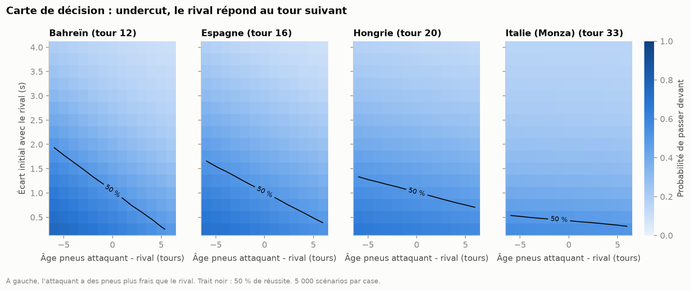
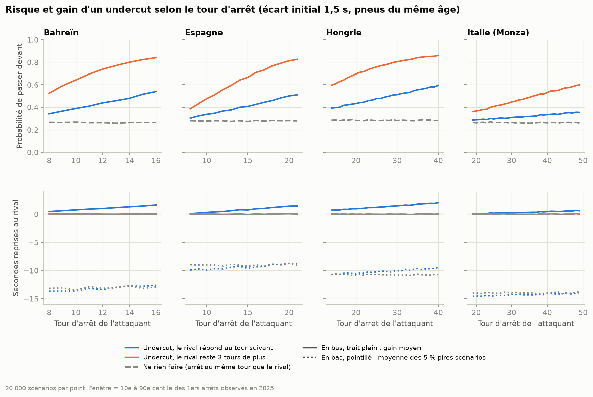
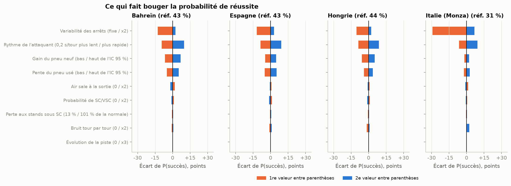

# Simulateur de risque d'undercut F1

Un pilote roule une seconde et demie derrière son rival. S'il s'arrête un tour avant lui pour profiter de pneus neufs, quelle est la probabilité qu'il ressorte devant, combien gagne-t-il en moyenne, et combien peut-il perdre dans les mauvais scénarios ? Je réponds avec un Monte Carlo calibré sur les 24 Grands Prix de la saison 2025, puis je confronte ses prédictions aux vraies tentatives de la saison.

## Pourquoi ce projet

Dans le [Moteur de stratégie et de télémétrie F1](../moteur-strategie-telemetrie-f1), je comparais des stratégies avec des paramètres moyens. Le projet notait lui-même la limite : il ignorait les safety cars, alors qu'en course elles pèsent beaucoup sur le moment de l'arrêt. Je voulais traiter la décision comme on traite un risque. On ne s'arrête pas à l'espérance de gain : on regarde toute la distribution des résultats, la probabilité de succès et le pire cas.

C'est le cadre de mon métier dans les risques : une décision prise sous incertitude, avec un gain probable modeste et une perte rare mais lourde. Ici, le terrain de jeu est plus simple et les données sont publiques, ce qui permet de vérifier si le modèle colle à la réalité.

## Ce que j'ai fait

**Dépendance au moteur de stratégie.** Ce projet réutilise le code du moteur de stratégie (le paquet `f1engine`), installé en mode éditable dans l'environnement de ce projet :
- le client OpenF1 ;
- l'ingestion et le nettoyage des tours ;
- le schéma SQL ;
- la reconstruction des safety cars à partir des messages de la direction de course ;
- le modèle de dégradation.

Il ne lit ni n'écrit rien dans le dossier de données du moteur de stratégie : il a sa propre base (`data/f1_2025.db`) et son propre cache. Il faut donc que le dossier `projets/moteur-strategie-telemetrie-f1` soit présent à côté de celui-ci.

**Les données.** J'ai chargé les 24 courses de 2025 depuis OpenF1, sans la télémétrie. Deux points d'attention dans les données :
- Melbourne et Monaco contenaient quelques relais incohérents (fin avant le début), 9 au total. Je les retire avant l'insertion, sinon le schéma du moteur de stratégie rejette toute la course.
- À Miami, OpenF1 ne donne pas les tours 1 à 24. La course est gardée avec ce trou.

Sur les 4 circuits du moteur de stratégie, la méthode est la même mais les pentes ne sont pas exactement identiques. Depuis le premier téléchargement, OpenF1 a révisé l'âge de départ de 5 trains de pneus, ce qui déplace certaines pentes de 0,0015 s/tour au plus. Un test vérifie que l'écart reste sous 0,002.

**Le modèle.** L'attaquant A est à `g` secondes derrière le rival R au début du tour N. Je simule tour par tour jusqu'à la fin du tour de sortie du dernier des deux à s'arrêter. A réussit s'il est devant à ce moment. Le temps de chaque tour est la somme de plusieurs éléments :

| Élément | Source | Valeur (4 circuits principaux) | Incertitude simulée |
|---|---|---|---|
| Écart de rythme par composé et dégradation par tour d'âge | modèle B du moteur de stratégie, par circuit | pente du pneu usé de 0,018 (Monza) à 0,149 s/tour (Bahreïn) | tirage normal avec la covariance clusterisée par relais |
| Évolution de la piste | terme « numéro de tour » du même modèle | de −0,001 à −0,023 s/tour | idem |
| Bruit d'un tour à l'autre | écart-type des résidus de la régression | 0,33 à 0,62 s | normal, indépendant |
| Perte aux stands | chaque arrêt sous drapeau vert, même définition que la requête 04 du moteur de stratégie | médiane de 22,0 à 25,5 s, sur 16 à 38 arrêts | rééchantillonnage des arrêts observés |
| Safety car et VSC | messages de direction de course, 24 courses, 1er tour exclu | 13 SC et 13 VSC sur 1 421 tours, soit 0,9 % par tour pour chacun | loi Gamma (Poisson, a priori de Jeffreys) |
| Perte aux stands sous neutralisation | arrêts sous SC/VSC comparés aux voitures restées en piste sur les mêmes tours | 66 % de la perte normale sous SC (36 arrêts), 80 % sous VSC (11 arrêts) | rééchantillonnage |
| Trafic à la sortie | écart à la voiture devant au premier tour après la sortie | ressort à moins de 1,5 s dans 13 % (Espagne) à 36 % (Bahreïn) des cas | rééchantillonnage |
| Coût de l'air sale | régression avec effet fixe par relais, toute la saison | 0,34 s par tour (erreur standard 0,025) | tirage normal |

**Comment la perte aux stands entre dans la simulation.** La perte mesurée vaut (tour d'entrée + tour de sortie) − 2 × tour normal du pilote. C'est le surcoût d'un arrêt par rapport à deux tours normaux, y compris le bruit aléatoire de ces deux tours. Le simulateur l'ajoute donc une seule fois, au tour d'entrée. Il simule le tour de sortie comme un tour normal en pneus neufs et ne tire aucun bruit supplémentaire sur ces deux tours. Dans une première version, je tirais quand même ce bruit, ce qui le comptait deux fois. L'effet de la correction est faible : au plus 3 points sur la probabilité de réussite et 0,24 s sur la moyenne des 5 % pires scénarios, tous circuits et tours d'arrêt confondus.

Les règles qui changent le scénario :
- **Safety car ou VSC pendant la fenêtre.** Toute voiture qui ne s'est pas encore arrêtée s'arrête sur ce tour avec la perte réduite, puis les écarts sont gelés. C'est le scénario redouté : A a payé son arrêt plein tarif, et R s'arrête juste après pour un tiers de moins.
- **Trafic.** Si A ressort à moins de 1,5 s d'une autre voiture, il perd le coût de l'air sale sur ses tours en pneus neufs. Son tour de sortie n'est pas concerné, parce qu'il est déjà compris dans la perte aux stands mesurée.

Je compare trois scénarios, sur les mêmes tirages pour que les écarts entre eux ne viennent pas du hasard :
- undercut, et le rival répond au tour suivant ;
- undercut, et le rival reste 3 tours de plus en piste ;
- ne rien faire : A s'arrête au même tour que R.

L'arrêt est obligatoire dans tous les cas. La question porte sur le moment, pas sur le fait de s'arrêter. Chaque point est calculé sur 20 000 scénarios, avec une graine fixe.

**La validation.** Je cherche dans les 24 courses les vraies tentatives d'undercut. Une tentative remplit toutes ces conditions :
- au début du tour N, A est juste derrière R dans l'ordre de course, à moins de 3 s (mesuré avec les heures de passage sur la ligne) ;
- A s'arrête au tour N, et R entre N+1 et N+3 ;
- les pneus des deux voitures ont au moins 5 tours ;
- la piste est sous drapeau vert aux tours N-1 et N.

Pour chaque tentative, j'estime les paramètres hors échantillon, autant que c'est possible :
- les paramètres du circuit (rythme, dégradation, arrêts, trafic) sans les deux pilotes concernés ;
- les paramètres de saison (safety cars, pertes sous neutralisation, air sale) sans la course.

Un vrai « leave-one-race-out » n'est pas possible pour les paramètres du circuit, puisque chaque circuit n'a qu'une course en 2025 et que la perte aux stands dépend du tracé.

## Ce que ça donne

### La carte de décision



La frontière des 50 % se déplace beaucoup d'un circuit à l'autre. À pneus du même âge, l'undercut a plus d'une chance sur deux de passer :
- sous 1 à 1,25 s d'écart à Bahreïn, en Espagne et en Hongrie ;
- sous 0,25 à 0,5 s seulement à Monza.

La carte est calculée par pas de 0,25 s, d'où ces fourchettes.

Avoir des pneus plus frais que le rival compte surtout là où ils s'usent vite. À Bahreïn, 5 tours d'avance sur l'âge des pneus repoussent la frontière de 1 à 1,75 s. À Monza, presque rien ne bouge.

### Risque et gain selon le tour d'arrêt



Au tour d'arrêt médian de chaque circuit, avec un écart initial de 1,5 s (l'écart médian des vraies tentatives) et des pneus du même âge :

| Circuit (tour) | P(réussite), rival qui répond | P(réussite), rival qui reste 3 tours | P(réussite), ne rien faire | Gain moyen | 5e centile | Moyenne des 5 % pires |
|---|---|---|---|---|---|---|
| Bahreïn (12) | 44 % | 74 % | 26 % | +1,0 s | −7,3 s | −13,4 s |
| Espagne (16) | 43 % | 71 % | 28 % | +0,9 s | −6,4 s | −9,4 s |
| Hongrie (20) | 43 % | 70 % | 28 % | +1,0 s | −8,4 s | −10,6 s |
| Monza (33) | 31 % | 47 % | 26 % | +0,3 s | −12,0 s | −14,3 s |

Le gain et les centiles sont exprimés en secondes reprises au rival, pour le scénario où il répond au tour suivant. Plus l'arrêt est tardif, plus l'undercut rapporte, parce que le pneu usé du rival perd davantage à chaque tour. La fenêtre réelle d'arrêt dépend bien sûr d'autres choses, comme la durée du relais suivant, que ce modèle ne regarde pas.

Deux colonnes sont à lire avec prudence :
- **Le scénario où le rival reste 3 tours de plus** est une limite du modèle plus qu'un résultat. Le rival y perd du temps à chaque tour sur des pneus usés, sans aucune des raisons qui rendent ce choix rationnel en course (voir Limites). Ses 47 à 74 % de réussite surestiment donc l'avantage de l'attaquant.
- **Les chiffres de Monza sont fragiles.** Ils reposent sur 16 arrêts seulement, dont quelques-uns très lents (30 à 39 s pour une médiane de 25,5 s). Ce sont ces arrêts-là qui font l'essentiel du pire cas et de la probabilité de réussite, comme le montre l'analyse de sensibilité.

### Ce qui fait bouger le résultat



Écart de probabilité de réussite entre le réglage bas et le réglage haut de chaque hypothèse, en moyenne sur les 4 circuits :

| Hypothèse | Amplitude |
|---|---|
| Variabilité des arrêts (fixe ou doublée) | 20 points (36 à Monza) |
| Rythme propre de l'attaquant, ±0,2 s/tour | 18 points |
| Gain du pneu neuf, bornes de l'IC 95 % | 10 points |
| Pente du pneu usé, bornes de l'IC 95 % | 8 points |
| Air sale à la sortie, coupé ou doublé | 2 points |
| Bruit tour par tour | 2 points |
| Probabilité de SC/VSC, nulle ou doublée | 2 points |
| Perte aux stands sous SC, 13 % ou 101 % de la normale | 1 point |
| Évolution de la piste, nulle ou triplée | 0 point |

**Pourquoi l'évolution de la piste ne change rien.** La piste gagne bien du temps au fil de la course : 0,023 s par tour à Bahreïn, l'estimation la plus forte. Mais les deux voitures roulent les mêmes tours, donc ce gain s'ajoute des deux côtés de l'écart et s'annule exactement dans le modèle. En réalité, A passe à un point donné au plus 25 s après R (écart initial plus perte aux stands). Sur la fenêtre de 3 tours, la piste a donc évolué pour lui d'au plus 3 × 0,023 × 25 / 98 = 0,018 s. C'est 2 % du gain moyen d'un undercut à Bahreïn, et c'est encore moins ailleurs (fichier `docs/results/track_evolution.csv`). J'ai gardé le terme dans le modèle, et un test vérifie qu'il ne modifie pas l'écart.

### Confrontation avec les vraies tentatives

J'ai trouvé 43 tentatives d'undercut en 2025. Le simulateur en évalue 36. Les 7 autres sont à Spa, en Autriche ou au Japon, où un composé n'a pas assez de tours propres pour estimer sa dégradation, ou bien la régression n'est pas identifiable.

| | Valeur |
|---|---|
| Tentatives réussies | 17 sur 36 |
| Réussites attendues par le simulateur | 16,2 (intervalle à 90 % des tirages [12 ; 21]) |
| Score de Brier du simulateur | 0,227 |
| Score de Brier d'une probabilité constante égale au taux observé | 0,249 |
| Score de Brier de pile ou face | 0,250 |

| Probabilité prédite | Tentatives | Prédiction moyenne | Taux observé |
|---|---|---|---|
| 0 à 25 % | 5 | 20 % | 40 % |
| 25 à 50 % | 16 | 38 % | 31 % |
| 50 à 75 % | 13 | 58 % | 69 % |
| 75 à 100 % | 2 | 81 % | 50 % |

Le nombre total de réussites tombe pile dans ce qu'annonce le simulateur, et son score de Brier est un peu meilleur que celui des deux références naïves. Mais avec 36 cas, cette différence n'est pas significative, et les tranches de calibration contiennent trop peu de tentatives pour dire si le modèle est bien calibré. Je ne peux pas conclure que le simulateur prédit bien. Je peux seulement dire que les données de 2025 ne le contredisent pas. Le graphique de chaque tentative est dans [`docs/validation.png`](docs/validation.png).

## Ce que j'en retiens

- **Le pire cas d'un undercut ressemble beaucoup au pire cas de ne rien faire.** À Bahreïn, la moyenne des 5 % pires scénarios vaut −13,4 s avec l'undercut et −13,2 s sans. Ce qui coûte cher, c'est un arrêt raté, et il peut arriver au tour N comme au tour N+1. Si je fixe la perte aux stands à sa médiane, cette moyenne des 5 % pires remonte de −13,2 s à −2,1 s. L'undercut ajoute peu de risque de queue. Comparé à « ne rien faire », il est meilleur dans 81 % (Monza) à 93 % (Bahreïn) des scénarios simulés.
- **La safety car pèse moins que je ne le pensais sur cette décision précise.** Il y a 5,4 % de chances qu'une neutralisation tombe dans une fenêtre de 3 tours. Quand c'est le cas entre les deux arrêts, c'est grave : A perd environ 8 s. Mais c'est rare. Le risque de safety car compte bien plus pour le choix de la fenêtre d'arrêt sur toute la course, une question que je ne traite pas ici.
- **À Monza, l'undercut ne fonctionne presque pas, et les chiffres l'expliquent.** Les pneus s'y usent à 0,018 s/tour. Un tour de pneus neufs y rapporte donc moins que la dispersion des arrêts aux stands. Quand je fixe la perte aux stands à sa médiane, la probabilité de réussite tombe de 31 % à 2 %. Presque toutes les chances de l'attaquant viennent donc d'un arrêt plus rapide que celui du rival. Comme cette conclusion repose sur 16 arrêts, je la considère comme fragile.
- **Après les arrêts, c'est le rythme propre des pilotes qui compte le plus.** Deux dixièmes par tour d'écart de rythme pèsent plus que l'incertitude sur les pneus. Le modèle suppose deux voitures de même rythme, ce qui est rarement vrai dans un duel réel.
- **Les ratios de perte sous safety car sont très bruités.** Brut, ils allaient de −1,7 à 4,2. Les valeurs extrêmes venaient d'arrêts au premier tour avec des dégâts, d'un accrochage (Sainz et Lawson à Zandvoort) ou d'une safety car déclenchée pendant le tour d'entrée. J'ai écarté les arrêts des tours 1 et 2 et les ratios hors de [0 ; 1,5]. C'est un choix de ma part, et la table complète est gardée dans `docs/results/neutralised_pit_losses.csv`.

## Limites

- **La validation reste optimiste.** Les paramètres de chaque circuit viennent de la même course que la tentative testée, même si j'en retire les deux pilotes concernés. Les conditions du jour (température, usure réelle, piste) sont donc en partie connues du modèle. Un vrai test hors échantillon demanderait une autre saison sur les mêmes circuits.
- **Échantillon de validation réduit.** 36 tentatives évaluées, dont deux seulement au-dessus de 75 % de probabilité. Ma définition d'une tentative est aussi une approximation : je ne sais pas si l'équipe visait vraiment l'undercut, si le rival a répondu volontairement ou avait prévu de s'arrêter à ce tour, ni s'il y avait des consignes d'équipe.
- **Comportement du rival.** Dans le modèle, le rival s'arrête à un tour fixé à l'avance. En réalité, il réagit à ce qu'il voit, et une équipe peut aussi doubler ses arrêts (deux voitures à la suite) et perdre du temps dans les stands. Le scénario « le rival reste 3 tours de plus » est le point le plus faible du modèle. Il donne 47 à 74 % de réussite à l'attaquant, parce que le rival y perd simplement du temps sur des pneus usés. Le modèle ignore tout ce qui rend l'overcut efficace en course : pneus neufs qui chauffent mal, attaquant bloqué dans le trafic, rival qui prépare une fin de course sur des pneus plus frais. Ces chiffres ne doivent pas servir à décider, et la validation ne les teste presque pas (3 tentatives réelles avec une réponse au 3e tour).
- **Trafic simplifié.** Le trafic à la sortie est tiré dans la distribution observée, sans tenir compte de la position réelle des autres voitures ce jour-là. L'attaquant reste derrière la voiture qu'il rattrape, sans possibilité de dépasser. L'écart OpenF1 est mesuré à la voiture qui précède au classement, pas forcément celle qui est physiquement devant. Le coût de l'air sale (0,34 s/tour) est une moyenne sur toute la saison. Il peut aussi refléter le fait que les pilotes en trafic gèrent leurs pneus.
- **Safety cars difficiles à prévoir.** 26 neutralisations sur une saison, c'est peu. Le taux est le même pour tous les circuits et pour tous les tours, alors que certains circuits (Melbourne, Zandvoort) en concentrent beaucoup et que les incidents arrivent plus en début de course. Je ne modélise pas le regroupement du peloton derrière la voiture de sécurité ni les drapeaux rouges (un seul en 2025, au 1er tour à Spa, exclu). L'ordre en piste est juste, mais l'écart en secondes après une neutralisation ne l'est pas.
- **Pertes aux stands.** Elles incluent les pénalités purgées à l'arrêt et les problèmes mécaniques, que je ne sais pas séparer. Tous les arrêts d'un circuit sont mélangés, comme si toutes les équipes avaient le même équipage aux stands. Or c'est la première source d'incertitude du modèle. La séparation entre perte aux stands et bruit des tours reste approximative : le tour normal de référence est une moyenne de tours voisins, sur pneus usés et neufs mélangés.
- **Monza est le circuit le plus fragile.** Seulement 16 arrêts mesurables, dont 3 au-dessus de 29 s (Norris, Ocon, Stroll). Retirer ou ajouter un arrêt lent change visiblement la probabilité de réussite et le pire cas. Les conclusions sur Monza sont des ordres de grandeur.
- **Peu de courses par circuit.** Une seule course par circuit pour la dégradation, avec un écart de rythme entre composés fragile (le moteur de stratégie le notait déjà). Sur Melbourne, Silverstone et Spa, courses mouillées ou très perturbées, la régression n'est pas identifiable.
- **Ce que le modèle ignore.** La montée en température des pneus neufs (en partie comprise dans la perte aux stands mesurée), une dégradation non linéaire, les consignes d'équipe et les écarts de rythme entre pilotes, supposés nuls dans les scénarios de référence.

## Lancer le projet

Il faut Python 3.11 ou plus récent (testé avec 3.14 sur macOS) et le dossier du moteur de stratégie à côté de celui-ci (`projets/moteur-strategie-telemetrie-f1`), dont le code est réutilisé. Il n'y a ni compte, ni clé d'API, ni base distante. La base du moteur de stratégie n'est pas nécessaire.

```bash
cd projets/simulateur-risque-undercut-f1
python3 -m venv .venv
source .venv/bin/activate
pip install -r requirements.txt
pip install -e ../moteur-strategie-telemetrie-f1   # code du moteur de stratégie (dépendance)
pip install -e .

python -m f1risk all   # ingestion de la saison + paramètres, simulations, validation, graphiques
pytest                 # 16 tests ; celui de cohérence avec le moteur de stratégie demande la base locale
```

Le premier lancement télécharge environ 170 réponses d'OpenF1 (près de 100 Mo, gardés dans `data/raw/`). À cause de la limite de débit de l'API, cela prend 6 à 7 minutes. Les lancements suivants lisent le cache, et l'analyse prend une quinzaine de secondes. On peut lancer les étapes séparément : `python -m f1risk ingest` ou `analyze`. Pendant une session de F1 en direct, OpenF1 refuse les requêtes anonymes, même sur les courses passées (erreur 401, « Live F1 session in progress ») : il faut relancer `python -m f1risk ingest` après la fin de la session.

Ce qui est produit :
- `data/f1_2025.db` : la base SQLite de la saison, avec le schéma du moteur de stratégie (non versionnée, régénérable) ;
- `docs/*.png` : les quatre graphiques ;
- `docs/results/*.csv` : paramètres estimés, résultats par tour d'arrêt, carte de décision, sensibilité, neutralisations et validation.

```
simulateur-risque-undercut-f1/
├── sql/queries/
│   └── pit_losses.sql   # perte de chaque arrêt sous drapeau vert
├── src/f1risk/
│   ├── ingest.py        # saison 2025 via le code du moteur de stratégie, sans télémétrie
│   ├── params.py        # estimation des paramètres (circuit et saison)
│   ├── simulator.py     # Monte Carlo du duel
│   ├── validation.py    # vraies tentatives et calibration
│   └── plots.py         # graphiques
├── tests/               # simulateur, paramètres, détection des tentatives, cohérence avec le moteur de stratégie
└── docs/                # graphiques et résultats CSV
```

## Stack

- Python 3.14
- OpenF1 (API publique)
- numpy pour le Monte Carlo vectorisé
- pandas
- statsmodels pour les régressions
- SQLite via SQLAlchemy
- matplotlib pour les graphiques
- pytest
- Code d'ingestion, de nettoyage et de dégradation repris du moteur de stratégie (`f1engine`)

## Statut

Terminé (v1). Pistes pour la suite : valider sur la saison 2026 avec des paramètres estimés sur 2025, un taux de safety car qui dépend du circuit et du moment de la course, et un rival qui réagit à l'écart au lieu de s'arrêter à un tour fixé.
