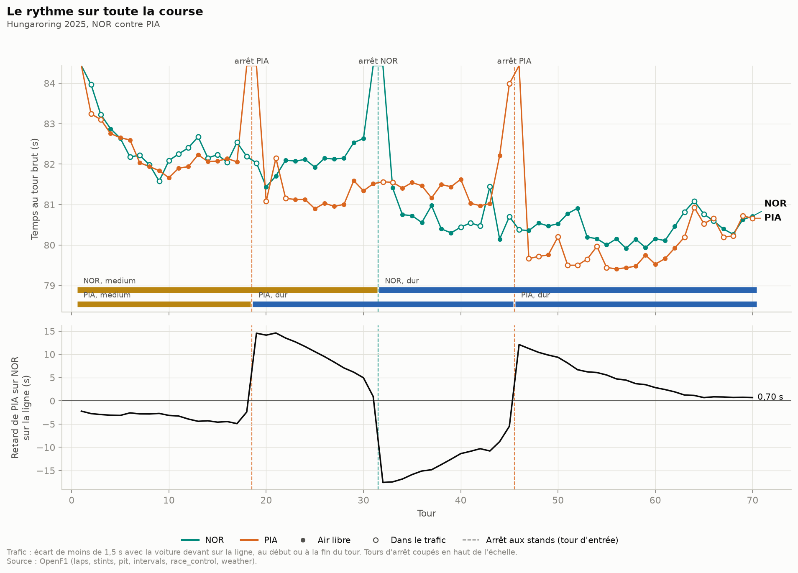
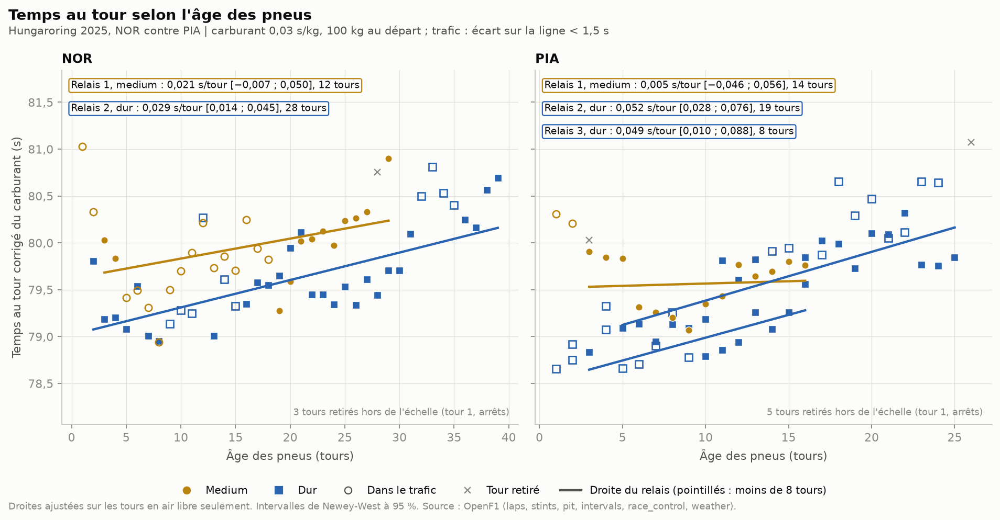
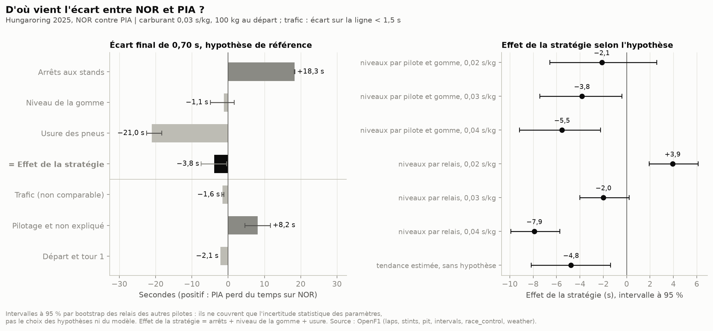

# Usure des pneus F1

Au Grand Prix de Hongrie 2025, Norris gagne avec un seul arrêt et Piastri finit 0,70 s derrière avec deux. La stratégie à deux arrêts a-t-elle coûté du temps à Piastri ? Je mesure l'usure des pneus tour par tour, en traitant un par un tout ce qui ralentit une voiture sans que le pneu y soit pour quelque chose. Je dis ensuite ce que les données permettent de conclure, et ce qu'elles ne permettent pas.

Réponse courte : les données ne permettent pas de trancher, car l'hypothèse sur le carburant suffit à faire basculer le signe, d'une perte de 3,9 s à un gain de 7,9 s pour Piastri.

## Pourquoi ce projet

Un tour plus lent ne prouve pas que le pneu s'use. La voiture peut être derrière une autre, la piste peut changer, le réservoir se vide, une neutralisation ou une consigne d'équipe peut casser le rythme. Si je trace le temps au tour contre l'âge des pneus sans rien corriger, je mesure un mélange de tout ça.

Le [Moteur de stratégie F1](../moteur-strategie-f1) estime déjà une pente de dégradation par gomme sur quatre courses, et le projet [Risque d'undercut F1](../risque-undercut-f1) s'en sert. Ici, je change d'échelle : une seule course, deux pilotes, une question précise. Le cœur du projet n'est pas la pente elle-même. C'est de montrer comment elle bouge quand on change chaque hypothèse, et si la réponse à la question tient malgré ça.

## Ce que j'ai fait

**La course et les pilotes.** J'ai cherché une course sèche, sans safety car, où deux pilotes de rythme proche ont choisi des stratégies différentes. La Hongrie 2025 coche tout :
- aucun tour sous safety car ou sous VSC, pas de pluie ;
- Norris : medium du tour 1 au tour 31, puis dur jusqu'au tour 70 (un arrêt) ;
- Piastri : medium jusqu'au tour 18, dur du tour 19 au tour 45, puis un nouveau train de durs (deux arrêts) ;
- la même voiture, et 0,70 s d'écart à l'arrivée.

La course, l'année et les deux pilotes sont des options de la commande. J'ai aussi fait tourner le projet sur Abu Dhabi 2025 (Piastri contre Norris) pour vérifier que les paramètres fonctionnent sur une autre course. Je n'en tire pas de résultat ici.

**Les données.** J'utilise [OpenF1](https://openf1.org), comme dans les autres projets du portfolio. Le projet est autonome : il a son propre petit client, avec un cache disque et une limite de débit. Neuf requêtes suffisent pour une course : `sessions`, `drivers`, `laps`, `stints`, `pit`, `race_control`, `intervals`, `weather` et `session_result`. Pour la Hongrie, cela fait 1 369 tours chronométrés et 4,7 Mo en cache.

**L'écart avec la voiture devant.** C'est la mesure qui sert à repérer le trafic. Chaque tour commence par un passage sur la ligne. Pour un tour donné, je cherche la dernière autre voiture passée sur la ligne juste avant, quel que soit son nombre de tours : un retardataire compte aussi. L'écart est la différence entre les deux heures de passage. Je le calcule au début et à la fin du tour, et je garde le plus petit des deux, pour voir une voiture rattrapée en cours de tour. Je n'utilise pas les passages dans la voie des stands, au début d'un tour de sortie : la voiture n'est pas devant sur la piste. Je note aussi si la voiture devant est sur le même tour ou si c'est un retardataire, parce que ce n'est pas le même trafic.

OpenF1 donne aussi un écart, mais avec la voiture qui précède au classement, pas forcément celle qui est devant sur la piste. Pour le leader, cet écart vaut 0 : je le traite comme vide, puisqu'il n'a personne devant. Je garde cet écart comme variante pour comparer.

**Le nettoyage.** Chaque tour reçoit au plus un motif de retrait, le premier de cette liste. Tous les seuils sont des options :

| Filtre | Règle | Tours retirés (NOR, PIA, peloton) |
|---|---|---|
| Tour 1 | départ arrêté | 1, 1, 20 |
| Sans temps | OpenF1 ne donne pas de durée | 0, 0, 1 |
| Entrée et sortie des stands | d'après `pit` et `laps` | 2, 4, 58 |
| Neutralisation | safety car, VSC, drapeau rouge, d'après les messages de la direction de course, plus 30 s pour le tour de relance | 0, 0, 0 |
| Drapeau jaune | même source ; un jaune jamais refermé dure 60 s | 0, 0, 0 |
| Tour annulé | message « TIME … DELETED », retrouvé par le temps publié ou, à défaut, par l'heure du message | 1, 0, 15 |
| Pluie | une mesure `rainfall` pendant le tour | 0, 0, 0 |
| Gomme pluie ou inconnue | intermédiaires, pluie, gomme absente | 0, 0, 0 |
| Valeur aberrante | plus de 1,0 s d'écart à la médiane glissante sur 7 tours du même relais | 0, 2, 46 |

Il reste 66 tours pour Norris, 63 pour Piastri et 1 229 pour le peloton. Les deux drapeaux jaunes de la course tombent avant le départ et ne touchent aucun tour. Pour les valeurs aberrantes, une médiane sur tout le relais aurait été plus simple, mais elle aurait rejeté les tours de fin d'un long relais, c'est-à-dire justement l'usure que je cherche. Le tableau complet par pilote est dans `docs/results/hungaroring_2025_retraits.csv`.

Le trafic n'est pas un retrait. Un tour compte comme « dans le trafic » si l'écart avec la voiture devant est sous 1,5 s. Selon l'hypothèse testée, ces tours sont retirés, gardés, ou gardés avec une variable qui mesure leur coût. Dans la version de référence, je les retire : il reste 40 tours en air libre pour Norris, 41 pour Piastri et 685 pour le peloton.

**Le carburant.** Une voiture plus légère va plus vite, donc le temps au tour baisse au fil de la course, même avec des pneus qui s'usent. Je retire au temps de chaque tour le coût du carburant encore à bord : 100 kg au départ, consommés à débit constant, et 0,03 s par kg. Ces deux valeurs sont des hypothèses courantes, pas des mesures, et je les fais varier.

Le piège est le suivant. Dans un relais, l'âge du pneu et le numéro de tour avancent exactement ensemble. Les données d'un relais ne peuvent donc pas séparer l'usure de l'allègement : c'est l'hypothèse qui tranche. Avec 70 tours, chaque 0,01 s/kg de plus ajoute exactement 0,0143 s/tour à la pente. Je teste aussi une variante sans hypothèse de carburant : un terme en numéro de tour est estimé sur les données. C'est possible parce que l'âge du pneu repart à zéro à chaque arrêt, alors que le numéro de tour continue. Ce terme mélange l'allègement et l'évolution de la piste, que rien ne permet de séparer.

**La méthode.** Une régression du temps corrigé sur l'âge des pneus :
- **la pente par gomme** est estimée sur tout le peloton, avec un niveau propre à chaque relais. Elle ne vient donc que de l'évolution à l'intérieur des relais, pas des écarts entre pilotes ;
- les tours d'un même relais ne sont pas indépendants : les erreurs standard sont regroupées par relais, avec une loi de Student à G − 1 degrés de liberté (G = nombre de relais) ;
- une gomme n'a de pente commune qu'avec au moins 3 relais venant d'au moins 2 pilotes. Le tendre a servi à 4 pilotes, mais il ne lui reste pas 3 relais en air libre : pas de pente commune ;
- **la pente d'un relais seul** est une droite dans ce relais, avec des erreurs de Newey-West. Je ne l'affiche qu'à partir de 8 tours propres ;
- pour vérifier qu'un seul pilote ne porte pas le résultat, je refais l'estimation sans Norris, puis sans Piastri.

**La réponse à la question.** Je découpe l'écart final de Piastri sur Norris en six parts, dont la somme redonne exactement 0,70 s :
- **arrêts** : pour chaque arrêt, le tour d'entrée et le tour de sortie, moins les deux tours normaux que le modèle prévoit à cet endroit ;
- **niveau de la gomme** : l'écart de rythme entre medium et dur neufs, sur les tours où les deux pilotes n'ont pas la même gomme ;
- **usure des pneus** : la pente multipliée par l'âge des pneus, tour par tour, pour chacun ;
- **trafic** : le coût estimé d'un tour derrière une voiture du même tour, et derrière un retardataire ;
- **départ et tour 1** ;
- **pilotage et non expliqué** : tout le reste.

Les trois premières forment l'effet de la stratégie. Pour estimer le niveau de chaque gomme, il faut cette fois un niveau par pilote et par gomme, et non par relais. Je calcule donc la décomposition avec deux modèles :
- **niveaux par pilote et gomme** : il estime l'écart entre medium et dur ;
- **niveaux par relais** : il ne l'estime pas, et le niveau de la gomme passe alors dans « pilotage et non expliqué ».

S'y ajoute la variante sans hypothèse de carburant. Le carburant lui-même s'annule dans la comparaison, puisque les deux voitures font les mêmes tours : il ne joue que par la pente.

L'incertitude vient d'un bootstrap : 2 000 tirages, dans lesquels je tire au hasard les relais des autres pilotes, chaque pilote gardant son nombre de relais. Ceux de Norris et de Piastri restent fixes, puisque ce sont eux qu'on explique. Cet intervalle ne couvre que l'incertitude statistique des paramètres, pente comprise. Il ne couvre ni l'hypothèse de carburant, ni le choix du modèle, ni le choix des filtres. C'est pour cela que je présente la décomposition sous chaque hypothèse.

**Les figures.** Matplotlib, fond clair. Les couleurs de Pirelli (rouge, jaune, blanc) ne marchent pas sur fond clair : le jaune et le blanc disparaissent. J'ai pris un rouge framboise pour le tendre, un ocre pour le medium et un bleu pour le dur. J'ai vérifié qu'on les distingue encore avec les trois formes courantes de daltonisme, simulé avec les matrices de Machado, Oliveira et Fernandes (2009). Chaque gomme a aussi sa forme de marqueur (triangle, rond, carré), pour ne pas dépendre de la couleur. Les deux pilotes sont en sarcelle et en orange, nommés directement sur les courbes.

## Ce que ça donne

### Le rythme sur la course



Après le premier tour, Piastri est 2e et Norris 5e. Norris passe une grande partie de son premier relais à moins de 1,5 s de la voiture devant (ronds vides). Piastri s'arrête au tour 18, Norris prolonge jusqu'au tour 31 et ressort devant. Le second arrêt de Piastri, au tour 45, le renvoie à 12 s. Avec des pneus neufs, il reprend environ 0,6 s par tour pendant 19 tours, puis l'écart se fige entre 0,7 et 0,9 s dans les six derniers tours, quand il roule dans le sillage de Norris.

### La dégradation



| Gomme | Pente (s/tour) | IC 95 % | Tours en air libre | Relais | Pilotes |
|---|---|---|---|---|---|
| Medium | 0,049 | [0,037 ; 0,060] | 234 | 17 | 16 |
| Dur | 0,050 | [0,036 ; 0,063] | 440 | 24 | 19 |

Avec 0,03 s/kg, un tour d'âge coûte environ 0,05 s, sur le medium comme sur le dur. Les relais pris un par un vont de −0,02 à 0,17 s/tour (36 relais d'au moins 8 tours, figure `docs/hungaroring_2025_pentes_relais.png`). Le relais en dur de Norris est l'un des plus bas : 0,029 s/tour [0,014 ; 0,045] sur 28 tours en air libre, contre 0,052 [0,028 ; 0,076] pour le premier relais en dur de Piastri.

### Ce qui bouge et ce qui ne bouge pas

Une hypothèse change à la fois, les autres restent à la référence (figure `docs/hungaroring_2025_effet_corrections.png`, fichier `docs/results/hungaroring_2025_scenarios_pentes.csv`) :

| Hypothèse | Medium (s/tour) | Dur (s/tour) |
|---|---|---|
| Référence (0,03 s/kg, air libre à 1,5 s, aberrants à 1,0 s) | 0,049 | 0,050 |
| Aucune correction du carburant | 0,006 | 0,007 |
| 0,02 s/kg | 0,034 | 0,035 |
| 0,04 s/kg | 0,063 | 0,064 |
| 95 kg ou 110 kg au départ | de 0,046 à 0,053 | de 0,047 à 0,054 |
| Tendance estimée sur les données | 0,058 | 0,051 |
| Tours dans le trafic gardés | 0,039 | 0,040 |
| Trafic gardé, avec une variable de coût | 0,049 | 0,046 |
| Air libre à 1,0, 2,0 ou 3,0 s | de 0,047 à 0,051 | de 0,047 à 0,049 |
| Écart OpenF1 à la voiture qui précède au classement | 0,051 | 0,050 |
| Aberrants à 1,5 s | 0,050 | 0,051 |
| Sans filtre des aberrants | 0,050 | 0,053 |
| Sans Norris ou sans Piastri | de 0,049 à 0,050 | de 0,050 à 0,052 |

- **Le carburant fait tout.** Sans correction, la pente tombe presque à zéro : l'allègement masque l'usure. Entre 0,02 et 0,04 s/kg, elle va de 0,034 à 0,063 s/tour pour le medium, et de 0,035 à 0,064 s/tour pour le dur. C'est plus que l'intervalle statistique.
- **La tendance estimée sur les données** vaut −0,044 s/tour. Si elle venait entièrement du carburant, elle correspondrait à 0,031 s/kg, très proche de l'hypothèse de référence. Mais une piste qui gagne en adhérence produirait le même signal. La concordance est rassurante, elle ne prouve rien.
- **Garder les tours dans le trafic** baisse la pente d'environ 0,01 s/tour. Le trafic tombe surtout en début de relais, quand on ressort dans le peloton : les pneus neufs paraissent alors plus lents qu'ils ne sont. Avec une variable qui mesure le coût du trafic (0,61 s par tour), la pente revient à la référence.
- **Le seuil d'air libre et la source de l'écart** changent peu la pente : de 0,047 à 0,051 s/tour.
- **Les valeurs aberrantes** non plus. Au seuil de 1,5 s, ou sans filtre, la pente bouge de 0,001 à 0,003 s/tour, bien moins que son intervalle.
- **Aucun des deux pilotes ne porte le résultat** : sans l'un ou sans l'autre, la pente bouge de 0,0025 s/tour au plus (le dur sans Norris), soit 0,002 avec les valeurs arrondies du tableau.

### La stratégie a-t-elle coûté du temps à Piastri ?



Décomposition de référence (niveaux par pilote et gomme, 0,03 s/kg). Un nombre positif est du temps perdu par Piastri sur Norris :

| Part | Valeur | IC 95 % (bootstrap) |
|---|---|---|
| Arrêts | +18,3 s | [18,2 ; 18,4] |
| Niveau de la gomme | −1,1 s | [−4,9 ; 1,7] |
| Usure des pneus | −21,0 s | [−22,5 ; −18,3] |
| **Effet de la stratégie** | **−3,8 s** | **[−7,4 ; −0,4]** |
| Trafic | −1,6 s | [−1,7 ; −1,2] |
| Pilotage et non expliqué | +8,2 s | [4,6 ; 11,7] |
| Départ et tour 1 | −2,1 s | |
| **Écart final** | **+0,70 s** | |

L'arrêt de plus coûte 18,3 s à Piastri. Ses pneus plus frais lui en rendent 21,0. Avec cette hypothèse, sa stratégie lui fait gagner 3,8 s. C'est ailleurs qu'il perd la course : 8,2 s dans la part « pilotage et non expliqué ».

Mais l'effet de la stratégie dépend de l'hypothèse :

| Modèle | 0,02 s/kg | 0,03 s/kg | 0,04 s/kg |
|---|---|---|---|
| Niveaux par pilote et gomme | −2,1 s [−6,6 ; 2,6] | −3,8 s [−7,4 ; −0,4] | −5,5 s [−9,2 ; −2,2] |
| Niveaux par relais | +3,9 s [1,9 ; 6,1] | −2,0 s [−4,0 ; 0,2] | −7,9 s [−9,9 ; −5,7] |
| Tendance estimée sur les données | −4,8 s [−8,2 ; −1,4] | | |

La réponse est donc : **je ne peux pas trancher.** Selon l'hypothèse de carburant et le modèle, la stratégie à deux arrêts a fait gagner à Piastri jusqu'à 8 s ou lui a coûté jusqu'à 4 s. Six versions sur sept donnent un gain, dont quatre avec un intervalle qui exclut zéro, et la variante qui ne demande aucune hypothèse de carburant en fait partie. Mais une hypothèse tout aussi défendable (0,02 s/kg, niveaux par relais) donne une perte, avec un intervalle qui exclut zéro lui aussi. Les intervalles des deux hypothèses extrêmes ne se recouvrent pas : le choix de l'hypothèse pèse plus que le hasard.

Trois points rendent la décomposition encore plus fragile que ces chiffres :
- **Le trafic des deux pilotes n'est pas comparable.** Après le premier tour, Norris est 5e et Piastri 2e. Norris passe donc plus de temps derrière d'autres voitures en début de course. Plus tard, il mène et rattrape des retardataires. Sur leurs tours gardés, Norris roule 18 tours derrière une voiture du même tour et 8 derrière un retardataire. Piastri en roule 15 et 7, surtout après son dernier arrêt. Il est à moins de 1,5 s de la voiture devant sur les huit derniers tours, derrière Norris sur six d'entre eux. La ligne « trafic » (−1,6 s) applique à ces tours un coût moyen estimé sur le peloton. Elle ne dit pas ce que chacun a vraiment perdu.
- **Le pilotage et la stratégie se mélangent.** La décomposition applique la même pente aux deux pilotes. Or celle du relais en dur de Norris est presque deux fois plus faible que celle du peloton. Un pilote qui doit tenir 39 tours en dur gère ses pneus : sa stratégie change sa façon de rouler. Une partie des 8,2 s de « pilotage » vient probablement de là, mais je ne peux pas dire laquelle.
- **Les arrêts mesurés ne sont pas seulement du temps aux stands.** D'après OpenF1, les trois passages dans la voie des stands durent tous de 20,9 à 21,1 s. Pourtant, la perte que je mesure est de 23,2 s pour l'arrêt de Norris et de 20,6 et 20,9 s pour ceux de Piastri. La différence est dans les tours d'entrée et de sortie, sur la piste, et je ne sais pas l'attribuer.

### Les facteurs parasites, un par un

| Facteur | Ce que j'ai fait | Ce qui reste non contrôlé |
|---|---|---|
| Carburant | correction explicite (100 kg, 0,03 s/kg, débit constant), sensibilité de 0,02 à 0,04 s/kg et de 95 à 110 kg, variante sans hypothèse avec une tendance estimée | la vraie masse et la vraie consommation de chaque voiture ; dans un relais, l'usure et l'allègement restent indiscernables |
| Trafic | écart avec la voiture devant sur la piste, au début et à la fin du tour, retardataires séparés ; seuils de 1,0 à 3,0 s ; tours retirés, gardés, ou gardés avec une variable de coût | ce qui se passe entre deux passages sur la ligne ; le coût réel du trafic pour chaque pilote ; l'aspiration en ligne droite, qui peut rendre un tour plus rapide |
| Météo | température de piste et pluie rattachées à chaque tour ; tour retiré s'il pleut | pas de pluie ici, et une piste qui ne varie que de 30,6 à 32,3 °C pendant les tours de course : son effet ne peut pas être estimé |
| Neutralisations | safety car, VSC, drapeaux rouges et jaunes reconstruits depuis les messages de la direction de course | un incident sans message, un jaune local mal refermé ; il n'y en a aucun pendant cette course |
| Tours annulés | retirés, retrouvés par le temps publié | un message d'une autre forme passerait inaperçu |
| Consignes d'équipe et gestion | rien : OpenF1 ne donne pas les messages radio en texte | une consigne de garder la position ou de ménager les pneus finit dans « pilotage et non expliqué » |
| Évolution de la piste | confondue avec le carburant ; la variante avec tendance mesure leur somme | leur part respective |
| Gestion des pneus par le pilote | visible dans les pentes par relais (Norris plus bas que le peloton) | non séparable de l'usure : le modèle ne sait pas si un pilote ménage ses pneus ou si ses pneus s'usent moins |

## Ce que j'en retiens

- **Le carburant décide de la pente.** Je savais que la correction comptait. Je n'avais pas mesuré qu'à l'intérieur d'un relais, elle fixe la pente à elle seule, à 0,014 s/tour près par 0,01 s/kg. Une pente de dégradation publiée sans son hypothèse de carburant ne veut pas dire grand-chose.
- **Le trafic fausse la pente dans un sens précis.** Il tombe surtout en début de relais. Si on le garde, les pneus neufs paraissent plus lents, et la dégradation paraît plus faible.
- **Un écart « à la voiture devant » doit être défini avant d'être utilisé.** Voiture devant sur la piste ou au classement, retardataire ou non, leader ou non : chaque choix change les tours qui comptent comme du trafic.
- **Des intervalles étroits peuvent être trompeurs.** Chaque version de la décomposition a un intervalle de 4 à 9 s de large, mais les versions s'étalent de −7,9 à +3,9 s. L'incertitude qui compte ici est celle des hypothèses, pas celle de l'échantillon.
- **La question de départ était mal posée pour ces données.** « La stratégie a-t-elle coûté du temps ? » suppose qu'on peut rejouer la course de Piastri avec un seul arrêt. On ne peut pas, parce que sa façon de rouler aurait changé avec sa stratégie.

## Limites

- **Une seule course, un seul circuit.** Tout ce qui précède vaut pour la Hongrie 2025. Le Hungaroring est un circuit où il est difficile de dépasser, et le trafic y pèse plus qu'ailleurs.
- **Peu de relais par gomme.** 17 relais en medium et 24 en dur pour tout le peloton. Norris n'a que 2 relais, Piastri 3. Le tendre n'a pas de pente commune. Une pente de relais sur 8 à 15 tours a un intervalle très large.
- **Les chiffres de carburant sont des hypothèses.** 100 kg au départ, 0,03 s par kg et un débit constant sont des ordres de grandeur, pas des mesures. La consommation réelle dépend du rythme, des phases de gestion et de chaque équipe. Toutes les pentes en dépendent directement.
- **La dégradation estimée dépend du modèle.** Linéaire, sans falaise. Avec un niveau par relais ou par pilote et par gomme, avec ou sans tendance, la pente et surtout la décomposition changent.
- **Corrélation n'est pas causalité.** Une pente mesure comment le temps évolue avec l'âge du pneu, toutes choses que j'ai pu contrôler égales par ailleurs. Ce que je n'ai pas contrôlé peut suivre l'âge du pneu aussi, et je ne peux pas l'exclure.
- **Pas de données sur les pneus eux-mêmes.** OpenF1 ne donne ni la température, ni la pression, ni l'usure mesurée des pneus. Je n'observe l'usure qu'à travers le chronomètre.
- **La comparaison de deux pilotes mélange stratégie et pilotage.** Même voiture, mais pas les mêmes réglages, pas le même départ, pas la même course. Le modèle applique la même pente aux deux, alors que Norris semble avoir ménagé ses pneus sur son long relais.
- **Le trafic de Norris et de Piastri n'est pas comparable.** Leurs positions après le départ diffèrent, et ils ne rencontrent pas les mêmes retardataires au même moment. Le coût du trafic est une moyenne du peloton.
- **L'intervalle du bootstrap ne couvre que l'incertitude statistique** des paramètres, pente comprise. Il ne couvre ni l'hypothèse de carburant, ni le modèle, ni les seuils des filtres. Les relais de Norris et de Piastri y restent fixes, ce qui ignore une partie de l'incertitude sur leur propre rythme. 3 tirages sur 2 000 n'ont pas pu être estimés dans la version de référence.
- **L'écart avec la voiture devant est approximatif.** Je ne le connais qu'aux passages sur la ligne. Une voiture rattrapée puis dépassée dans le même tour ne se voit pas. L'heure de passage d'OpenF1 n'est pas toujours exacte au centième.
- **Les seuils sont des choix.** 1,5 s pour l'air libre, 1,0 s pour les aberrants, 8 tours pour afficher un relais, 3 relais pour une gomme : je les ai fait varier pour les deux premiers, pas pour les autres.

## Lancer le projet

Il faut Python 3.11 ou plus récent (testé avec 3.14.10 sur macOS arm64). Il n'y a ni compte, ni clé d'API, ni base de données.

```bash
cd projets/usure-pneus-f1
python3 -m venv .venv
source .venv/bin/activate
pip install -r requirements.txt
pip install -e .

python -m f1pneus   # Hongrie 2025, Norris contre Piastri
pytest              # 19 tests, sans réseau
```

Le premier lancement fait neuf requêtes à OpenF1 (4,7 Mo), en une vingtaine de secondes. Les réponses sont gardées dans `data/raw/`, et les lancements suivants n'appellent plus l'API. L'analyse prend ensuite environ deux minutes, surtout pour les 7 × 2 000 tirages du bootstrap (`--tirages 200` pour aller plus vite). Pendant une session de F1 en direct, OpenF1 refuse les requêtes anonymes, même sur les courses passées (erreur 401, « Live F1 session in progress ») : il faut relancer la commande après la fin de la session.

Options utiles :
- `--circuit "Yas Marina Circuit" --annee 2025 --pilotes PIA NOR` : autre course et autres pilotes (nom court OpenF1 ; l'écart est celui du second sur le premier) ;
- `--carburant-s-kg 0.035 --carburant-depart 105` : hypothèse de carburant de référence ;
- `--air-libre 2.0`, `--ecart openf1` : seuil et source de l'écart pour le trafic ;
- `--aberrant 1.5` (0 pour ne pas filtrer), `--garder-jaunes`, `--garder-annules`, `--min-tours-relais 10` : les filtres ;
- `--tirages`, `--sortie` : nombre de tirages et dossier des résultats.

Ce qui est produit, avec un préfixe `<circuit>_<année>` :
- `docs/*.png` : les cinq figures (rythme, nuage par relais, pentes par relais, effet des corrections, décomposition) ;
- `docs/results/*_retraits.csv` : les tours retirés par motif et par pilote ;
- `docs/results/*_pentes_gommes.csv` et `*_pentes_relais.csv` : les pentes de référence ;
- `docs/results/*_scenarios_pentes.csv` : les pentes sous chaque hypothèse ;
- `docs/results/*_decomposition.csv` et `*_arrets.csv` : la décomposition sous chaque hypothèse et la perte de chaque arrêt.

```
usure-pneus-f1/
├── src/f1pneus/
│   ├── openf1.py         # client API avec cache et limite de débit
│   ├── config.py         # chemins, seuils et hypothèse de carburant par défaut
│   ├── donnees.py        # téléchargement et assemblage des tours
│   ├── nettoyage.py      # pneus, écarts, météo, neutralisations, tours annulés, filtres, carburant
│   ├── modele.py         # pentes par gomme et par relais, modèles de niveaux
│   ├── decomposition.py  # écart entre deux pilotes et bootstrap
│   ├── analyse.py        # hypothèses testées une à une
│   ├── figures.py        # les cinq figures
│   └── __main__.py       # la commande et ses options
├── tests/                # filtres, écarts, âge des pneus, carburant, pentes connues sur courses simulées, décomposition
└── docs/                 # figures et résultats CSV
```

Les tests de modèle construisent des courses simulées où la vraie dégradation est connue, avec du bruit, du carburant et du trafic en début de relais. Ils vérifient que l'estimation la retrouve, et qu'elle est biaisée quand on oublie le carburant ou qu'on garde le trafic.

## Stack

- Python 3.14
- OpenF1 (API publique)
- requests pour les appels à l'API
- pandas pour l'assemblage des tours (jointures sur l'heure, regroupements par relais)
- statsmodels pour les régressions et les erreurs regroupées par relais
- numpy pour le bootstrap
- matplotlib pour les figures
- pytest

## Statut

Terminé (v1). Pistes pour la suite : appliquer la même méthode à plusieurs courses pour voir si l'incertitude sur le carburant se réduit, et trouver une source sur la consommation réelle des voitures.
